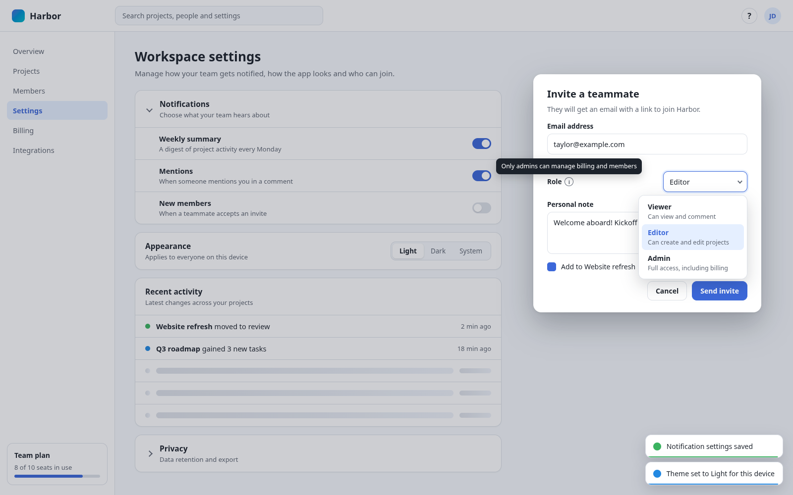

# ui

[](https://www.npmjs.com/package/@cplieger/ui) [](https://jsr.io/@cplieger/ui) [](https://github.com/cplieger/ui/issues?q=label%3Astryker-tracker)

`@cplieger/ui` lets you build a TypeScript browser UI without a framework, from signals, accessible widgets, typed JSON requests and server actions.



It replaces the change listeners, focus handling, `try`/`catch` blocks and loading flags you would otherwise write by hand. It has no runtime dependencies and ships as ESM-only TypeScript source, so it needs a bundler that compiles TypeScript 6 or later. The widgets need Chrome or Edge 132, Firefox 133 or Safari 26 or later. It is licensed under Apache-2.0.

## Why use it

`@cplieger/ui` is built for apps that draw their interface with plain DOM code and keep their own look.

- A signal write runs every effect that depends on it before it returns, and every subpath shares that one signal graph.
- `bindList` repaints only the row of a changed item, and `el` builds elements without HTML strings.
- The 15 widgets ship behavior and ARIA wiring with no colors or fonts, styled through `--uip-*` properties and `.uip-*` classes.
- Requests never throw, and actions add optimistic updates, rollback and retry for failures you mark as transient.
- A bundler drops every subpath you do not import.

Consider [Solid](https://github.com/solidjs/solid) if you want components, JSX and server-side rendering. Consider [TanStack Query](https://tanstack.com/query/latest) if you also need a server-state cache.

## Install

```sh
npx jsr add @cplieger/ui
# or
npm i @cplieger/ui
```

## Usage

A signal holds a value, and an effect re-runs when what it read changes. `el` builds the elements:

```typescript
import { effect, el, signal } from "@cplieger/ui";

const count = signal(0);
const label = el("output");
const button = el("button", { onclick: () => count.value++ }, "Add one");
document.body.append(button, label);

effect(() => {
  label.textContent = `Clicked ${count.value} times`;
});
```

Connect the toasts to the actions once at startup, then define each action at module scope and dispatch it from your event handlers:

```typescript
import { apiAction, configure, retryNetwork } from "@cplieger/ui/actions";
import { error, success } from "@cplieger/ui/toast";
import "@cplieger/ui/css";

configure({ success, error });

const deleteItem = apiAction<string>({
  name: "items.delete",
  request: (id) => ({ method: "DELETE", path: `/api/items/${id}` }),
  error: "Could not delete the item",
  retryable: retryNetwork,
  retry: { count: 2, delay: 300 },
});

await deleteItem.dispatch("item-1"); // the result, or null after the error toast
```

To call a JSON API directly, create one instance per backend and branch on the result:

```typescript
import { createFetch } from "@cplieger/ui/fetch";

const api = createFetch({ baseUrl: "https://api.example.com/v1" });

const res = await api.apiGetRaw<{ name: string }>("/users/me");
if (res.ok) console.log(res.data.name);
else console.error(res.status, res.code, res.error);
```

## Subpaths

Import each part from its own subpath. Code that imports one of the earlier packages, `@cplieger/reactive`, `@cplieger/ui-primitives`, `@cplieger/actions` or `@cplieger/fetch`, moves by the table in [Moving from the earlier packages](docs/migrating.md).

| Import from | What it holds |
| --- | --- |
| `@cplieger/ui` | everything in `/signal` and `/dom` |
| `@cplieger/ui/signal` | signals, computed values, effects, owners, resources, stores, collections and the event bus |
| `@cplieger/ui/dom` | `el`, `reconcile`, `bindList`, `patch` and `trackHandler` |
| `@cplieger/ui/fetch` | typed JSON requests |
| `@cplieger/ui/actions` | server actions |
| `@cplieger/ui/actions/testing` | `resetActionFramework` for tests |
| `@cplieger/ui/<widget>` | one widget, such as `@cplieger/ui/dialog` |
| `@cplieger/ui/icons` | a set of Lucide drawings and the factory that paints them |
| `@cplieger/ui/css` | the base stylesheet, on npm only |

The widget subpaths are `toast`, `tooltip`, `popover`, `popup`, `dialog`, `modal`, `ask`, `disclosure`, `focus-trap`, `roving-focus`, `skeleton`, `theme`, `view-transition`, `transition` and `announce`.

Eight widget subpaths start watching the `open` attribute of dialogs when they load, so they need a DOM at import: `dialog`, `modal`, `ask`, `announce`, `toast`, `popup`, `popover` and `tooltip`. The package root, `icons` and every other subpath touch no DOM at import, so they also run under Node, Deno, Bun or Workers. `package.json` marks the watching modules as side effects, so `import "@cplieger/ui/dialog"` keeps its watcher in a bundle.

## API

- Signals, from `/signal` or the root: `signal`, `computed`, `effect`, `batch`, `untracked`, `touch`, `on`, `subscribe`, `isSignal`, `isComputed`, `setEffectErrorHandler`, `createRoot`, `runWithOwner` and `resource`.
- State, from `/signal` or the root: `createStore`, `SignalMap`, `createCollection` and `createBus`.
- DOM, from `/dom` or the root: `el`, `reconcile`, `KEY_ATTR`, `bindList`, `patch` and `trackHandler`.
- Requests, from `/fetch`: `createFetch` with its `apiGet`, `apiPost`, `apiPut`, `apiPatch` and `apiDelete` helpers, `withTimeout` and `API_TIMEOUT_MS`.
- Actions, from `/actions`: `configure`, `configureApi`, `configureTransport`, `defineAction`, `apiAction`, `transportAction`, the helpers `debouncedDispatch`, `pollAction`, `pollUntil`, `bindLoadingState`, `withAsyncFeedback` and `registerCleanup`, and the state reads `isPending`, `pendingCount`, `subscribeToActions`, `subscribeByName` and `getActionLog`.
- Widgets, one subpath each: [toast](docs/toast.md), [announce](docs/announce.md), [tooltip](docs/tooltip.md), [popover](docs/popover.md), [popup](docs/popup.md), [dialog](docs/dialog.md), [modal](docs/modal.md), [ask](docs/ask.md), [focus-trap](docs/focus-trap.md), [roving-focus](docs/roving-focus.md), [disclosure](docs/disclosure.md), [theme](docs/theme.md), [view-transition](docs/view-transition.md), [transition](docs/transition.md) and [skeleton](docs/skeleton.md).
- Icons, from `/icons`: `createIcons` and `iconNames` ([icons](docs/icons.md)).

The full reference, generated from the doc comments, is on [JSR](https://jsr.io/@cplieger/ui/doc).

## A write runs its effects before it returns

When `count.value = 1` returns, every effect that depends on `count` has already run, so the next line reads the DOM those effects wrote. There is no queue and no pending state to wait for.

`batch(fn)` is the only way to defer. Writes inside it coalesce, and the held effects run once, synchronously, when the outermost batch returns, even when the body throws. To run effects on a later task, make the write on a later task. [Signals, stores and collections](docs/signals.md) has the full rules.

## Server text is untrusted

- With an absolute `baseUrl`, a request path cannot reach another origin. Without one, the path goes to `fetch()` unchanged, so never build a whole path from untrusted text.
- An error message can carry text from the server's response. Your `configure` adapter renders it as text, never as HTML. The toasts do that.
- A failed response's `body` and `code` come from the server. Check their shape and the `status` before you act on them.
- Set `sensitive: true` on an action whose arguments or result carry a secret, a token or personal data, so the action log keeps none of them.

[Base URLs and untrusted responses](docs/security-model.md) and [Sensitive actions](docs/lifecycle.md#sensitive-actions) cover each rule.

## Unsupported by design

- The signal and DOM modules leave out ownership outside a root, an `onMount` lifecycle, server-side rendering, Suspense, a custom scheduler, a flush barrier such as `flushSync`, and controlled form inputs. [What the signal and DOM modules leave out](docs/signal-non-goals.md) gives the reasons.
- The fetch module leaves out retries, interceptor chains, response caching, global settings and streamed responses. [What the fetch module leaves out](docs/fetch-non-goals.md) gives the reasons.
- The actions module leaves out a query cache, framework adapters, a throttle helper and batch dispatch. [What the actions module leaves out](docs/actions-non-goals.md) gives the reasons.

## Documentation

- [Signals, stores and collections](docs/signals.md) and [Building and updating the DOM](docs/dom.md) give the exact rules of `/signal` and `/dom`.
- [Results and errors](docs/results.md), [Requests, timeouts and runtimes](docs/requests.md) and [Base URLs and untrusted responses](docs/security-model.md) cover `/fetch`.
- [Dispatch lifecycle](docs/lifecycle.md), [HTTP and streaming actions](docs/http.md) and [UI and polling helpers](docs/helpers.md) cover `/actions`.
- [CSS contract](docs/css.md) covers the base stylesheet and the names you style. Each widget's page is linked from the [API](#api) list.
- [Moving from the earlier packages](docs/migrating.md) maps each import of `@cplieger/reactive`, `@cplieger/ui-primitives`, `@cplieger/actions` and `@cplieger/fetch` and lists what behaves differently.

## Credits

- The signal engine follows the design of [@preact/signals-core](https://github.com/preactjs/signals) in its dependency graph, its glitch-free computed refresh, its run-on-write effects and its untracked `subscribe` callback.
- The `on()` helper follows [Solid](https://github.com/solidjs/solid)'s `on()`, and `untracked()` is Solid's `untrack()` under the name Preact gives it. `createRoot`, `runWithOwner` and owned nested effects follow Solid's ownership model.
- `onSuccess`, `onError` and `onSettled` follow TanStack Query's mutation callbacks, and `configureApi` follows RTK Query's `fetchBaseQuery`.

## Contributing

See [CONTRIBUTING.md](CONTRIBUTING.md).

## Disclaimer

This project is built with care and follows security best practices, but it is intended for personal / self-hosted use. No guarantees of fitness for production environments. Use at your own risk.

This project was built with AI-assisted tooling using [Claude](https://claude.com), [GPT](https://openai.com), and [Kiro](https://kiro.dev). The human maintainer defines architecture, supervises implementation, and makes all final decisions.

## License

Apache-2.0. See [LICENSE](LICENSE).

Third-party attributions are in [THIRD_PARTY_NOTICES.md](THIRD_PARTY_NOTICES.md).
