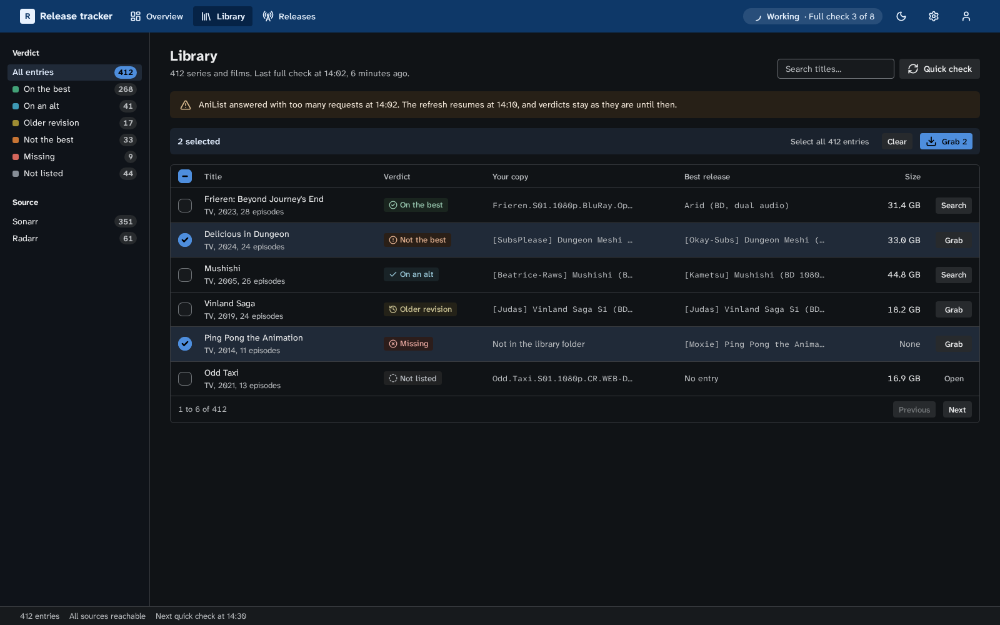

# ui

[](https://www.npmjs.com/package/@cplieger/ui) [](https://jsr.io/@cplieger/ui) [](https://github.com/cplieger/ui/issues?q=label%3Astryker-tracker)

`@cplieger/ui` is a design language and the components built on it, for browser apps that draw their interface with plain HTML and DOM code.



The stylesheet styles the browser's own elements and a set of `.cp-*` classes, in light and dark, from a few colour seeds each app sets. Each script adds only what the browser lacks, such as a menu's keys or a toast's queue. It has no runtime dependencies and ships as ESM-only TypeScript source, so it needs a bundler that compiles TypeScript 6 or later. It needs Chrome or Edge 147, Firefox 147 or Safari 26.4 or later.

## Why use it

- Dialogs, popovers and disclosures are the browser's own `<dialog>`, `popover` and `<details>`, so focus, Escape, a press outside a popover and the top layer work with no script.
- Every control is one height and sizes itself for a mouse or a finger from the last real pointer, so a row of fields and buttons lines up on a desktop and under a thumb.
- The stylesheet computes every colour step, both themes and the harmony colours from an accent hue and a neutral hue, and a test holds each pair of text and fill to its contrast.
- Each component starts from a call you make and touches nothing as it loads, so a bundler drops what you do not import. One that stays on the page takes an `AbortSignal` for its lifetime.

Consider [Pico CSS](https://picocss.com) for classless styles on content pages, or [Shoelace](https://shoelace.style) for web components.

## Install

```sh
npm i @cplieger/ui
# or
npx jsr add @cplieger/ui
```

## Usage

Import the stylesheet, put `class="cp"` on `<html>` and set the seeds:

```typescript
import "@cplieger/ui/css/system";
```

```css
:root {
  --cp-accent-h: 255;
  --cp-accent-c: 0.137;
}
```

Build with its classes and the browser's elements, then add the scripts the page needs once at startup:

```html
<button class="cp-button" type="button" popovertarget="sort">Sort</button>
<div class="cp-popover cp-menu" popover id="sort" role="menu">
  <button role="menuitemradio" aria-checked="true" type="button">Name</button>
  <button role="menuitemradio" aria-checked="false" type="button">Added</button>
</div>
```

```typescript
import { installAnchors } from "@cplieger/ui/anchor";
import { enhanceMenu } from "@cplieger/ui/menu";
import { installPress } from "@cplieger/ui/press";
import { toast } from "@cplieger/ui/toast";

const page = new AbortController();
installPress({ signal: page.signal });
installAnchors({ signal: page.signal });
enhanceMenu(sortMenu, { signal: page.signal, onSelect: (item) => sortBy(item.textContent) });

toast({ kind: "success", title: "Source added" });
```

## Subpaths

| Import from | What it holds |
| --- | --- |
| `@cplieger/ui/css/system` | the design language's stylesheet, on npm only |
| `@cplieger/ui/fonts/*` | its two fonts, on npm only |
| `@cplieger/ui/icons` | Lucide's lines in the package's own stroke, a few drawings of its own, and the factory that paints them |
| `@cplieger/ui/<module>` | one component's script |

## API

Each module is one subpath, grouped here by what it is for:

- Overlays: [dialog](docs/overlays/dialog.md), [ask](docs/overlays/ask.md), [anchor](docs/overlays/anchor.md), [menu](docs/overlays/menu.md), [palette](docs/overlays/palette.md), [panel](docs/overlays/panel.md), [popconfirm](docs/overlays/popconfirm.md), [select-panel](docs/overlays/select-panel.md) and [tooltip](docs/overlays/tooltip.md).
- Feedback: [toast](docs/feedback/toast.md), [announce](docs/feedback/announce.md), [skeleton](docs/feedback/skeleton.md) and [chip](docs/feedback/chip.md).
- Buttons: [confirm](docs/buttons/confirm.md), [overflow](docs/buttons/overflow.md), [toggle](docs/buttons/toggle.md) and [turn](docs/buttons/turn.md).
- Forms: [form](docs/forms/form.md), [checkbox](docs/forms/checkbox.md), [choice](docs/forms/choice.md), [stepper](docs/forms/stepper.md), [secret](docs/forms/secret.md), [copy](docs/forms/copy.md), [tokens](docs/forms/tokens.md), [combobox](docs/forms/combobox.md), [search](docs/forms/search.md), [textarea](docs/forms/textarea.md), [range](docs/forms/range.md), [date-range](docs/forms/date-range.md), [file](docs/forms/file.md), [rules](docs/forms/rules.md), [pairs](docs/forms/pairs.md) and [connection-test](docs/forms/connection-test.md).
- Navigation and layout: [disclosure](docs/navigation/disclosure.md), [tabs](docs/navigation/tabs.md) and [list-detail](docs/layout/list-detail.md).
- Behaviour every page shares: [press](docs/core/press.md), [pointer](docs/core/pointer.md), [radio-focus](docs/core/radio-focus.md), [roving-focus](docs/core/roving-focus.md), [roll](docs/core/roll.md), [pill](docs/core/pill.md), [theme](docs/core/theme.md) and [view-transition](docs/core/view-transition.md).
- [icons](docs/foundations/icons.md): `createIcons`, `iconNames` and `ownIconNames`.

The full reference, generated from the doc comments, is on [JSR](https://jsr.io/@cplieger/ui/doc). For signals, keyed DOM rendering, requests and server actions, use [`@cplieger/reactive`](https://github.com/cplieger/reactive). An app on it passes its owner's `signal` to each component here.

## Documentation

- The [principles](docs/principles.md) are the decisions every part follows.
- The [design language](docs/design.md) covers type, layout, touch, shape and motion, and [colour](docs/design-colour.md) the seeds, steps, tones and harmony colours.
- [Components](docs/design-components.md) lists every class the stylesheet ships.
- [Design patterns](docs/design-patterns.md) covers loading, forms, tables, tabs, dialogs, notifications, first run, navigation and words, with [settings](docs/design-settings.md) and [account screens](docs/design-account.md) on their own pages.
- [Moving from the earlier subpaths](docs/migrating.md) maps each subpath earlier releases carried to its replacement.

## Credits

- The icons are [Lucide](https://lucide.dev)'s, redrawn in the package's stroke.
- The fonts are [Atkinson Hyperlegible Next](https://github.com/googlefonts/atkinson-hyperlegible-next) and [Atkinson Hyperlegible Mono](https://github.com/googlefonts/atkinson-hyperlegible-next-mono).
- The harmony colours follow the method of [pro-color-harmonies](https://github.com/meodai/pro-color-harmonies).

## Contributing

See [CONTRIBUTING.md](CONTRIBUTING.md).

## Disclaimer

This project is built with care and follows security best practices, but it is intended for personal / self-hosted use. No guarantees of fitness for production environments. Use at your own risk.

This project was built with AI assistance. The human maintainer defines architecture, supervises implementation, and makes all final decisions.

## License

Apache-2.0. See [LICENSE](LICENSE).

Third-party attributions are in [THIRD_PARTY_NOTICES.md](THIRD_PARTY_NOTICES.md).
