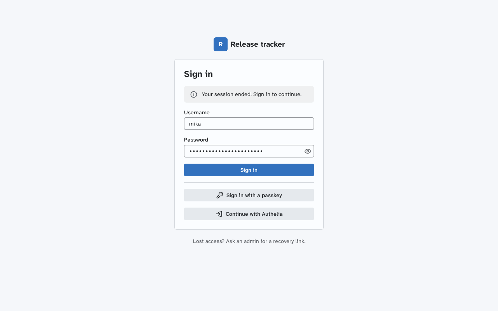
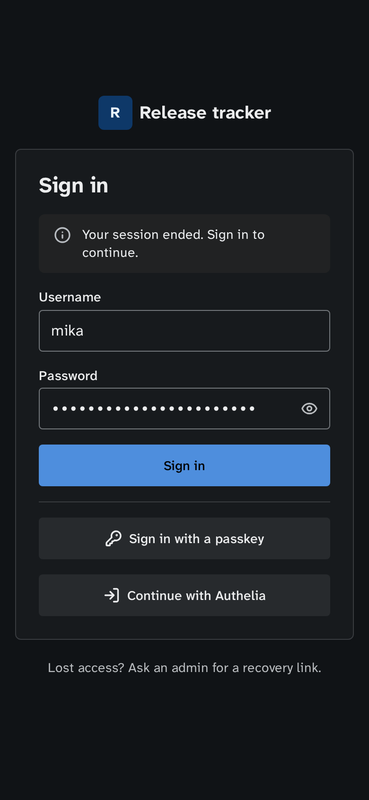
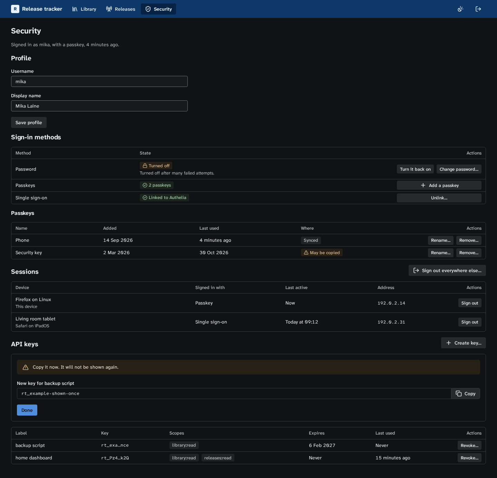

# Account and sign-in

This page covers the screens around the accounts of an app built on `@cplieger/access`, from sign-in to the security log. It builds on [Design patterns](design-patterns.md) and [Design language](design.md).

A screen shows a method or a section only when the app mounts its routes and `GET /api/auth/state` or `GET /api/auth/me` turns it on. A method that is off is absent, never a disabled control.

## The gate page

Sign-in, setup, invites and recovery links each open a gate page outside the app frame.

1. `.cp-gate` is the page's `<main>`. It holds the app's `.cp-wordmark` with its `.cp-mark`, one `.cp-panel` with the task, and at most one line under the panel.
2. The panel starts with the screen's `<h1>`, then a notice slot, then the form. Its buttons sit in a `.cp-stack`, so they take the panel's width.
3. One button on the page is primary, the main form's submit or else the only method.
4. `<title>` is the screen and the app, such as "Sign in · Release tracker". The theme follows the person's choice from `@cplieger/ui/theme`, which needs no account.

A password field holds a quiet Show button inside its end, in a `.cp-input-wrap`, so it keeps the width of the username field above it. The button has `eye` and `eye-off` and an `aria-pressed` that follows the state, which [secret](forms/secret.md)'s `enhanceReveal` keeps. Passwords here run to 15 characters or more, so reading one back saves a retry.

## Sign-in

In order, the panel holds:

1. The `<h1>` "Sign in".
2. The notice slot.
3. When password sign-in is on, a form with Username, Password and the primary "Sign in". Username takes `autocomplete="username"`, `autocapitalize="none"` and `spellcheck="false"`, and Password takes `autocomplete="current-password"`.
4. An `
`, then "Sign in with a passkey" with `key-round` when passkeys are on, and "Continue with" and the app's provider label when single sign-on is on.

When `passkeySupport()` reports `conditional`, the username field's `autocomplete` is `"username webauthn"` and the page starts `signInWithPasskey` with `mediation: "conditional"` on load, so the browser's autofill offers the passkeys. Abort it before the passkey button's own request or a password submit.

After a password sign-in, call `storePasswordCredential` so the browser offers to save it. Then go to the `next` query value when it is a path on this origin, starting with `/` and not `//`, or else to the app's home.

| Answer | Shows | Words |
| --- | --- | --- |
| `auth_invalid_credentials` | a danger notice, and focus on the password with its text selected | "The username or password is wrong." |
| `auth_rate_limited` | a warning notice with a countdown from `Retry-After`, the submit disabled until it ends | "Too many attempts. Try again in 0:42." |
| `auth_busy` | one silent retry after a second, then a danger notice | "The server is busy. Try again in a moment." |
| `auth_unavailable` | a danger notice | "Sign-in is unavailable right now. Try again in a few seconds." |
| `auth_username_invalid` | a field error on Username | "Enter your username." for `empty`, "Usernames have no spaces." for `disallowed_character` |
| passkey `cancelled` | nothing, since the person closed the prompt | |
| passkey `timeout`, `ceremony-expired` | a warning notice | "The passkey request ran out of time. Try again." |
| passkey `unknown-credential` | a warning notice | "That passkey is not registered here. Try another one, or sign in another way." |
| passkey `verification-failed` | a danger notice | "That passkey could not be checked. Try again." |
| `auth_origin_refused` | a danger notice | "Passkeys do not work at this address. Open the app at its usual address, or ask its admin to check its public URL." |
| arriving after `auth_session_expired` | a neutral notice | "Your session ended. Sign in to continue." |

The countdown announces its start and its end only. A lockout never shows here, because the server answers a locked method as a wrong password.

**Single sign-on.** The provider sends the browser back to a page, never a JSON error. `readOIDCReturn(location.search)` reads the outcome, and the page removes it from the URL with `history.replaceState`. An error shows as the notice for its code. For `auth_oidc_failed`, the reason picks the words:

| Reason | Words |
| --- | --- |
| `stale_authentication` | "Sign in at Authelia again, then continue." |
| `provisioning_disabled`, `not_admitted` | "Authelia signed you in, but no account here uses that identity. Ask an admin for an invite." |
| `no_username`, `username_invalid` | "Authelia sent no username this app can use. Ask its admin to check the username claim." |
| any other | "Single sign-on did not finish. Try again, or sign in another way." |

**Linking a new identity**, in an app that mounts the pending link. A return with `not_linked` shows a gate page "Link this identity" that names the provider and the `username_hint` from `pendingLink`. The person signs in with an existing method on that page, and `completePendingLink` then links the identity. `auth_identity_taken` says "That identity is linked to another account." and `auth_already_linked` says "Your account already has a single sign-on identity. Unlink it in Security first."

**A copied passkey.** A sign-in answer with `clone_warning` lands with a warning notice, "One of your passkeys may have been copied.", linked to the passkeys in Security.

## First run and invites

While `GET /api/auth/state` says `setup_required`, every address opens the setup gate, "Set up Release tracker", with a form to create the first account:

1. Setup token, where the app asks for one, with help naming the command that prints it. A setup link fills it.
2. Username, with help "Letters, digits, dots, dashes and underscores. No spaces."
3. Password, with `autocomplete="new-password"` and help "15 to 128 characters. A few unrelated words make a strong one." The page sets no `minlength` or `maxlength`, since those count code units rather than characters, and shows the server's refusal on the field.
4. The primary "Create account". Where the app offers a passkey instead, "Create with a passkey" sits under an `
`.

After it, the app opens on its own [first run](design-patterns.md#first-run) states.

| Answer | Words |
| --- | --- |
| `auth_setup_token_required` | on the token field, "Enter the setup token." |
| `auth_token_invalid` | on the token field, "That setup token does not work. Make a new one with the command above." |
| `auth_setup_complete` | the sign-in page, with a neutral notice "Setup is already done. Sign in." |
| `auth_breach_check_unavailable` | a warning notice, "The password check is not answering. Try again in a moment. Your password can stay as it is." |

Every new-password field shows `auth_password_rejected` on itself, by reason:

| Reason | Words |
| --- | --- |
| `too_short`, `too_long` | "Use 15 to 128 characters.", with the bounds the answer gives |
| `contains_username` | "Leave your username out of the password." |
| `contains_forbidden_word` | "Leave the app's name and words like "password" out of it." |
| `common` | "That password is too common. Choose another." |
| `breached` | "That password has appeared in a data breach. Choose another." |

**Links.** An invite, recovery or setup link carries its token as `#token=<value>`. The page reads it with `takeFragmentToken("token")` before anything else runs, which also removes it from the address bar.

**An invite**, in a multi-user app, opens such a link. The gate "Join Release tracker" asks for a username and a password, with "Create account". `auth_username_taken` says "That username is taken. Choose another." on the field. A missing token, or `auth_token_invalid` on submit, replaces the form with a `.cp-empty`: "This invite link does not work. Ask whoever sent it for a new one."

## Recovery

A recovery link opens a gate page that sends its token at once, with the panel busy as "Checking the link…".

1. On success the panel names the account, "Set a new password for mika", with a new-password field and the primary "Set password", or "Register a passkey" where the app recovers with one. The page lasts 15 minutes.
2. Two checkboxes, unchecked by default, keep what recovery otherwise ends: "Keep my other devices signed in" (`keep_sessions`) and "Keep my API keys" (`keep_keys`).
3. Recovery signs nobody in. The sign-in page opens with the username from the start answer filled in and a success notice, "Password set. Sign in with it."
4. `auth_token_invalid` replaces the panel with a `.cp-empty`: "This recovery link does not work." with the way to get another, an admin in a multi-user app or the app's own command in a single-owner one.
5. A recovery session that times out says "This recovery page timed out. Use a new recovery link."

## Step-up

An action that needs a recent sign-in runs through `withStepUp`. When the server asks for one, a `.cp-dialog` opens:

1. Its title is "Confirm it is you", and its sentence names the action, such as "Revoking a key needs a recent sign-in."
2. It offers only the methods the account holds, from a password field with the primary "Confirm" to "Use a passkey" and "Use Authelia". With a password, focus starts in the field. Otherwise it starts on the first method.
3. A wrong password is a field error, "The password is wrong.", since the person is signed in.
4. Cancel closes the dialog, shows no error, and returns focus to the action's control.
5. After a step-up, the action runs again once, and its result shows as usual.

Single sign-on leaves the page, so `withStepUp` cannot run the action again. Put the pending action in the redirect path, such as `?confirm=revoke-key-12`. On the return with `stepped_up`, open that action's confirmation again with focus on it, and never run a destructive action by itself after a redirect.

An `auth_recent_auth_required` with reason `reenable_needs_other_method` opens no dialog. The method's row says "Sign in with another method first, then turn this one back on." and names the methods that can.

## Account and security

The Security page has one `<h2>` section each for the profile, the sign-in methods, the sessions and the API keys, in that order, and the security log when the app shows it. Each section saves on its own, and its form's fields sit in a `.cp-form`.

**Profile.** Username and display name, saved with "Save profile". `auth_username_taken` shows on the field.

**Sign-in methods.** One row per method, each with a state chip and its actions:

- Password: "Set" or "Not set". Its actions are "Change password…", which asks for the current and the new one, "Set a password…" when there is none, and "Remove password…" in the apps that allow it.
- Passkeys: a `.cp-table` with the name, the date it was added, its last use, and a chip for "Synced" (`backed_up`) or "This device only". A passkey with `clone_warning` shows a warning chip "May be copied", and one whose `rp_id` is not this app's shows "Not usable here". Row actions are "Rename…" and "Remove…", and "Add a passkey" sits above the table.
- Single sign-on: "Linked to Authelia" with "Unlink…", or "Link Authelia" when `can_link_oidc` is true.
- A locked method, from `methods.locks`, gets a warning notice in its row: "Password sign-in was turned off after many failed attempts." with the action "Turn it back on".

When `GET /api/auth/me` says `sso_governed`, the password and passkey rows keep their state with no actions and the line "Authelia manages how you sign in." A refusal with `sso_governed` does the same.

| Answer | Words |
| --- | --- |
| `auth_last_method` | "Add a passkey or link single sign-on before you remove this." |
| `auth_duplicate_credential`, register `duplicate` | "That passkey is already on your account." |
| register `not-discoverable` | "That authenticator cannot keep a passkey for this app. Try another one." |
| `auth_identity_taken` | "That identity is linked to another account." |
| `auth_method_not_locked` | no words, and the section refreshes |
| `auth_not_found` | no words, and the list refreshes without the item |

`registerPasskey` tells the person's password manager about a new passkey. After a rename or a removal, call `sendSignals` so it follows.

**Sessions.** A `.cp-table` with this device first, marked "This device", then the others by last activity. Its columns are the label or else the browser, the sign-in method, the last activity as a `<time>`, and the address. Row actions are "Rename…" and "Sign out". The section's action is "Sign out everywhere else…", and its confirmation names the count, such as "Sign out 3 other sessions".

**API keys.** A `.cp-table` shows each key's label, its two ends in `.cp-mono`, scopes as chips, expiry and last use. "Create key…" asks for a label, scopes from the app's list, and an expiry of 30, 90 or 365 days or "Never". The key shows once. "Revoke…" asks first and says what stops, as in "Revoke backup script? Anything using it stops working at once."

## Secrets shown once

A new API key, an invite link and a recovery link show once, at creation, and no list carries them again.

1. Show it in the panel or dialog that made it, never in a toast, in a `.cp-code` with a `.cp-copy` button, as [copy](forms/copy.md) describes.
2. Above it, a warning notice: "Copy it now. It will not be shown again."
3. Hold it with `shownOnce`, which clears it on `pagehide`. "Done" dismisses it, and closing the dialog asks first while it has not been copied, which `enhanceCopy`'s `onCopy` tells the page.
4. Announce "Key created. Copy it now." politely.

## Admin

A multi-user app's admin pages use the [table patterns](design-patterns.md#tables):

- The users table shows the username, the display name, a role chip, an enabled or disabled chip, the methods and the creation date. Row actions are "Edit…", "Recovery link…" and "Delete…", and "Add user…" and "Invite…" sit above it.
- "Invite…" asks for a role and a lifetime, 7 days by default, and "Recovery link…" for a lifetime, 24 hours by default. Each link shows once. The live links table lists the purpose, the role, the dates and who made each one, never the link.
- The keys of every user use the API keys table with an Owner column.

Refusals say whose action it is, and what to do instead:

| `auth_forbidden` reason | Words |
| --- | --- |
| `last_admin` | "Make another user an admin first." |
| `last_local_admin` | "Keep another admin who signs in without single sign-on." |
| `self_delete` | "Another admin has to delete your account." |
| `self_recovery` | "Another admin has to make your recovery link." |
| `admin_target` | "Only an admin can change another admin." |
| `single_owner` | "This app has one owner." |
| any other | "This is not allowed." |

## Security log

A `.cp-table` of what succeeded and what changed, newest first:

1. Its columns are the time as a `<time>`, what happened, who did it and the address. The app words each kind it knows and shows an unknown one as sent. Who is a user, a key by its suffix, or the app's own command.
2. Each entry's class, change or session, is a chip. The filters are the kind and the person, and the answer's count for each class shows above the table.
3. "Older" asks for `before` the smallest seq shown, and "Newer" for `after` the largest with `oldest_first`, shown newest first again. There is no total, since entries keep arriving. A page holds 50 entries.
4. When the size limit has removed entries, a neutral notice above the table says how many, such as "312 older entries were removed."
5. Its help says that failed sign-ins are not recorded.

## Words

- "Sign in" and "Sign out", never "log in", "login" as a verb, or "log out".
- "Passkey" in lowercase inside a sentence, and "single sign-on" spelled out.
- No code, status or reason shows on screen.
- Never say which half of a credential was wrong, whether a username exists or why a link failed. On a sign-in screen, never say that a method is locked or how many attempts are left. "That username is taken" is the one exception, on screens where the person is signed in or invited.
