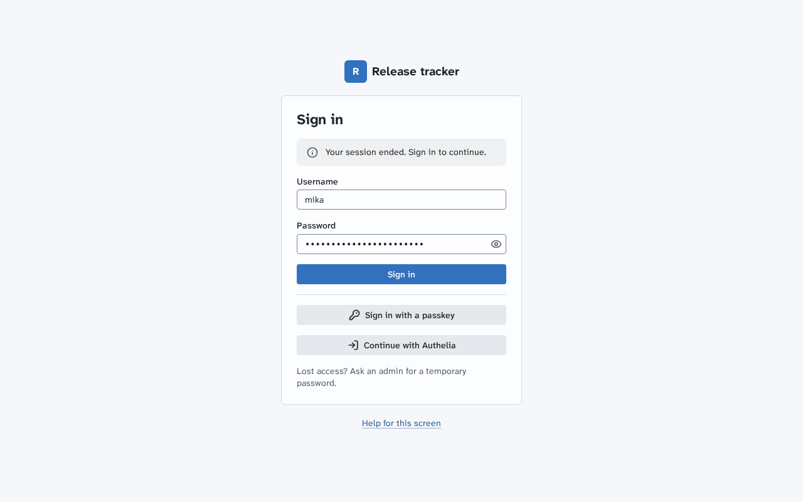
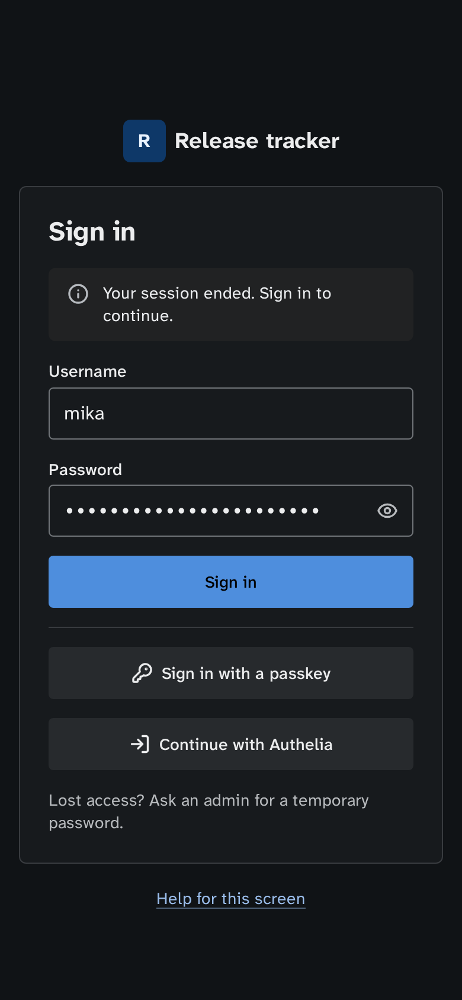
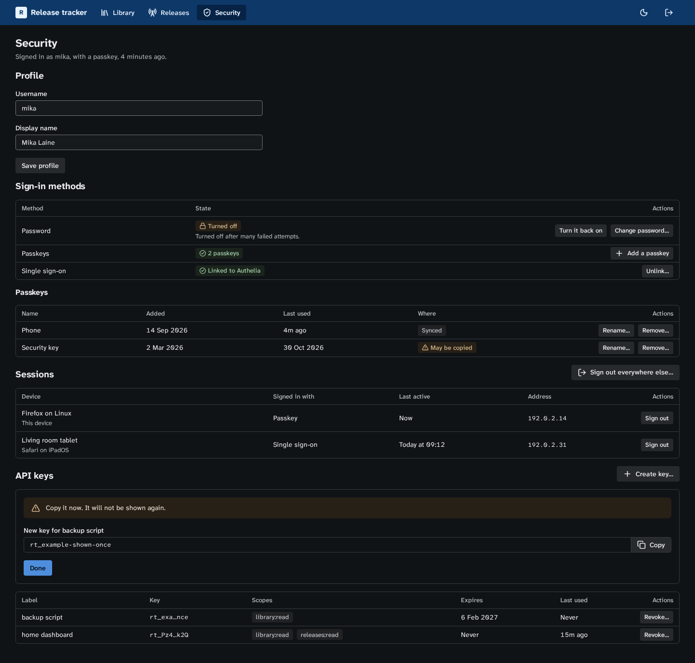

# Account and sign-in

This page covers the screens around the accounts of an app built on `@cplieger/access`, from sign-in to the security log. It builds on [Design patterns](design-patterns.md) and [Design language](design.md). The [account](screens/account.md) module draws every screen here, and its page says how an app mounts each one.

A screen shows a method or a section only when the app mounts its routes and `GET /api/auth/state` or `GET /api/auth/me` turns it on. A method the app leaves out is absent, never a disabled control. "Off in this app" is only for a method the app wires and has turned off.

## The gate page

Sign-in, setup and invites each open a gate page outside the app frame.

1. `.cp-gate` is the page's `<main>`. It holds the app's `.cp-wordmark` with its `.cp-mark`, one `.cp-panel` with the task, and at most one line under the panel, the app's own, such as a link to its help.
2. The panel starts with the screen's `<h1>`, then a notice slot, then the form. Its buttons sit in a `.cp-stack`, so they take the panel's width. The panel's last line says how to get back in, such as "Lost access? Ask an admin for a temporary password."

   A setup of several steps is `.cp-gate[data-variant="steps"]`. Its panel starts with the `.cp-steps` list and its `.cp-steps-compact` line, each done step a link back to its address, then the step's `<h1>`, its notice slot and its form. The step's buttons sit in one `data-part="actions"` row: Back first, a link to the step before, and the primary last. A setup inside such a step leaves out its own `<h1>`.
3. One button on the page is primary, the main form's submit or else the only method.
4. `<title>` is the screen and the app, such as "Sign in · Release tracker". The theme follows the person's choice from `@cplieger/ui/theme`, which needs no account.

A password field holds a quiet Show button inside its end, in a `.cp-input-wrap`, so it keeps the width of the username field above it. The button has `eye` and `eye-off` and an `aria-pressed` that follows the state, which [secret](forms/secret.md)'s `enhanceReveal` keeps. Passwords here run to 15 characters or more, so reading one back saves a retry.

## Sign-in

In order, the panel holds:

1. The `<h1>` "Sign in".
2. The notice slot.
3. When password sign-in is on, a form with Username, Password and the primary "Sign in". Username takes `autocomplete="username"`, `autocapitalize="none"`, `autocorrect="off"` and `spellcheck="false"`, and Password takes `autocomplete="current-password"`.
4. An `
`, then "Sign in with a passkey" with `key-round` when passkeys are on, and "Continue with" and the app's provider label when single sign-on is on.
5. The recovery hint.

When `passkeySupport()` reports `conditional`, the username field's `autocomplete` is `"username webauthn"` and the page starts `signInWithPasskey` with `mediation: "conditional"` on load, so the browser's autofill offers the passkeys. Abort it before the passkey button's own request or a password submit.

After a password sign-in, call `storePasswordCredential` so the browser offers to save it. Then go to the `next` query value when it is a path on this origin, starting with `/` and not `//`, or else to the app's home.

| Answer | Shows | Words |
| --- | --- | --- |
| `auth_invalid_credentials` | a danger notice, and focus on the password with its text selected | "The username or password is wrong." |
| `auth_rate_limited` | a warning notice with a countdown from `Retry-After`, the submit held until it ends | "Too many attempts. Try again in 0:42." |
| `auth_busy` | one silent retry after a second, then a danger notice | "The server is busy. Try again in a moment." |
| `auth_unavailable` | a danger notice | "Sign-in is unavailable right now. Try again in a few seconds." |
| `auth_username_invalid` | a field error on Username | "Enter your username." for `empty`, "Usernames have no spaces." for `disallowed_character` |
| `auth_sso_only` | a danger notice, and focus on the provider's button | "Use your organisation's sign-in." |
| passkey `cancelled` | nothing, since the person closed the prompt | |
| passkey `timeout`, `ceremony-expired` | a warning notice | "The passkey request ran out of time. Try again." |
| passkey `unknown-credential` | a warning notice | "That passkey is not registered here. Try another one, or sign in another way." |
| passkey `verification-failed` | a danger notice | "That passkey could not be checked. Try again." |
| `auth_origin_refused` | a danger notice | "Passkeys do not work at this address. Open the app at its usual address, or ask its admin to check its public URL." |

The countdown announces its start and its end only. A lockout never shows on the first step, because the server answers a locked method as a wrong password.

A sign-in that follows another step opens with a neutral notice: "Your session ended. Sign in to continue.", "Setup is already done. Sign in.", "You signed out." or "You were signed out because the connection changed between HTTP and HTTPS.".

**Single sign-on.** The provider sends the browser back to a page, never a JSON error. `readOIDCReturn(location.search)` reads the outcome, and the page removes it from the URL with `history.replaceState`. The return carries the code alone, so an error shows as the notice for its code: `auth_oidc_failed` says "Single sign-on did not finish. Try again, or sign in another way." and `auth_oidc_unavailable` "Single sign-on is unavailable right now. Try again in a moment, or sign in another way."

The app's single sign-on mode changes the panel:

- Alongside, the default, keeps the panel as above.
- For linked accounts adds the line "Accounts linked to Authelia sign in with it." under the provider's button, and a linked person's password attempt answers `auth_sso_only`.
- Single sign-on only shows one primary "Sign in with Authelia", then an inline disclosure "Owner sign-in" holding "For the app's owners." and the password form and passkey, since an owner keeps their own sign-in under every mode.

**Linking a new identity**, in an app that mounts the pending link. A return with `not_linked` shows "Link this identity" and "You signed in with Authelia as mika.", then:

1. "Link to an existing account": the person signs in to it on this page with a method other than single sign-on, and `oidcLinkPending` links the identity. Under single sign-on only, it asks instead for the account's username and the temporary password an admin gave them, with "Link account".
2. "Create a new account" where the answer allows it, with Username filled from the provider's suggestion and "Create account".

`auth_identity_taken` says "That identity is linked to another account." and `auth_already_linked` says "Your account already has a single sign-on identity. Unlink it first." A pending sign-in that lapsed, 10 minutes after the provider's answer, says "Your sign-in expired. Sign in with Authelia again." over the provider's button, for every form on the screen. `provisioning_disabled` says "New accounts by single sign-on are turned off. Ask an administrator."

**A copied passkey.** A sign-in answer with `clone_warning` reaches the app, whose page then shows a warning notice, "One of your passkeys may have been copied.", linked to the passkeys in Account and security.

## The second step

A password sign-in that needs more answers with a pending sign-in: a ticket, the next step and the methods it allows. The panel swaps its form for the step under the same `<h1>`, and keeps the ticket in memory only. Each answer's newer ticket replaces it, and a lapsed one, after 10 minutes, says "This sign-in timed out. Start again." and goes back to the form with the username kept.

- A second factor asks one way at a time, the code first, then a passkey, then the recovery code, each other way a quiet button such as "Use a passkey" or "Use your recovery code". The code is one field of 6 digits, with `inputmode="numeric"` and `autocomplete="one-time-code"`: "Enter the 6-digit code from your authenticator app." The recovery code field takes the 16 characters in any case, with or without dashes, and groups them in fours as typed.
- After a temporary password, "Choose your password" says "Your temporary password worked. Choose your own to finish signing in." and asks for a new password with "Save and sign in", or offers "Register a passkey instead".
- "Set up a second factor" comes when the app requires one and the account has none ("You used your recovery code. Set up a new authenticator" after a recovery code). It offers the QR code and key of an authenticator app with its first code, or "Register a passkey", only for the second factors the app wires.

| Answer | Words |
| --- | --- |
| `auth_code_invalid` `code_invalid` | on the field, "That code is not right." |
| `auth_code_invalid` `code_reused` | on the field, "That code was already used. Wait for the next one. If you did not just sign in elsewhere, someone else may have, and you should change your password." |
| `auth_code_invalid` `method_locked` | "Too many wrong codes. Sign in with a passkey to unlock it, or ask an admin to reset your authenticator app.", the passkey part only when one is allowed, and the way is dropped |
| `auth_rate_limited` | the countdown, with the submit held |
| `auth_totp_disabled` | the code field goes, the ticket stays |
| `auth_second_factor_unavailable` | "Codes from an authenticator app cannot be checked right now. Try again later, or confirm it is you another way." |
| `auth_password_rejected` `is_temporary_password` | "This is the temporary password you were given. Choose your own." |
| `auth_forbidden` `no_usable_method` | "This app allows no second factor this account can set up. Ask an administrator." |

When the step that binds the first second factor answers with a recovery code, the code shows once before the app opens ([Secrets shown once](#secrets-shown-once)).

**A temporary password.** An admin's temporary password is typed in the sign-in form. "Use a temporary password" under the password field relabels it "Temporary password", with the help "An admin gave it to you. You choose your own password next.", and the browser is never offered to save it. With password sign-in off, the field is labelled "Temporary password" alone.

## Plain HTTP

An app may answer over plain HTTP. Its state then says what needs HTTPS, and the screens follow it:

- Sign-in shows the password form only, with "Passkeys and single sign-on need HTTPS." under it, linked "Open Release tracker over HTTPS" when the app gives its HTTPS address, and the session's length: "You stay signed in for up to 12 hours, 30 minutes when idle, until you close the browser."
- An app that refuses passwords over plain HTTP shows "This app needs HTTPS." with the link, and no form.
- A temporary password works only over HTTPS. Over plain HTTP there is no switch, the line "A temporary password works only on `https://tracker.example`." sits beside the field, and a typed value that looks like one is never sent: "This looks like a temporary password, which works only on `https://tracker.example`. If this is your password, sign in there."
- In Account and security, the session line and the session's row read "Plain HTTP" as a warning `.cp-state`, with its end. Each action that needs HTTPS stays in place, focusable with `aria-disabled="true"`, described by "Needs HTTPS." with the link. Remove password is not offered at all.
- A recent sign-in over plain HTTP is a fresh password sign-in: a dialog "Sign in again to continue" with the username fixed, after which the action runs once more.

## First run and invites

While `GET /api/auth/state` says `setup_required`, every address opens the setup gate, "Set up Release tracker", with a form to create the first account:

1. Setup token, where the app asks for one, with help naming the command that prints it. A setup link fills it.
2. Username, with help "Letters, digits, dots, dashes and underscores. No spaces."
3. Password, with `autocomplete="new-password"` and help naming the app's bounds, `state()`'s `password_length`: "15 to 128 characters. A few unrelated words make a strong one." The page sets no `minlength` or `maxlength`, since those count code units rather than characters. It counts characters of the composed (NFC) form, as access does: a password outside the bounds is marked when the person leaves the field and refused before sending. The server's refusal shows on the field.
4. The primary "Create account". Where the app offers a passkey instead, "Create with a passkey" sits under an `
`.

After a password setup the app may offer a passkey: "Add a passkey to sign in without typing your password. You can also add one later.", with "Add a passkey" and "Skip". Then the app opens on its own [first run](design-patterns.md#first-run) states. Where the app requires a second factor, the answer is a pending sign-in whose next step is enrolment: the account exists, and the token is spent, only once the person sets one up. The screen continues into the sign-in's own setup step, and its recovery code, in the same panel.

| Answer | Words |
| --- | --- |
| `auth_setup_token_required` | on the token field, "Enter the setup token." |
| `auth_token_invalid` | on the token field, "That setup token does not work. Make a new one with the command above." |
| `auth_setup_complete` | the sign-in page, with a neutral notice "Setup is already done. Sign in." |
| `auth_breach_check_unavailable` | a warning notice, "The password check is not answering. Try again in a moment. Your password can stay as it is." |

An app may word the token's refusal by the page's address, such as one sentence at `localhost` or an IP address and another at a name.

Every new-password field shows `auth_password_rejected` on itself, by reason:

| Reason | Words |
| --- | --- |
| `too_short`, `too_long` | "Use 15 to 128 characters.", with the bounds from `state()` |
| `contains_username` | "Leave your username out of the password." |
| `contains_forbidden_word` | "Leave the app's name and words like "password" out of it." |
| `common` | "That password is too common. Choose another." |
| `breached` | "That password has appeared in a data breach. Choose another." |

**Links.** An invite or setup link carries its token as `#token=<value>`. The page reads it with `takeFragmentToken("token")` before anything else runs, which also removes it from the address bar.

**An invite**, in a multi-user app, opens such a link. The gate "Join Release tracker" asks for a username and a password, with "Create account", and offers "Accept with Authelia" when single sign-on is on, alone under single sign-on only. "This invite is for you alone. Do not forward it." sits under the form. `auth_username_taken` says "That username is taken. Choose another." on the field. Under the app's second-factor rule it continues into the same setup step as first run. A missing token, or `auth_token_invalid` on submit, replaces the form with a `.cp-empty`: "This invite link does not work. Ask whoever sent it for a new one." Accepting needs HTTPS.

## Getting back in

There are no recovery links. A person who lost every way in asks an admin for a temporary password, which they type in the sign-in form and then replace with their own password or passkey. A person who lost their second factor signs in with their recovery code, then sets up a new one.

The recovery code is one code of 16 characters, shown once when the first second factor is bound, and again whenever it is replaced or used. "Replace…" in Account and security makes a new one after a code from the authenticator app or a passkey.

## Step-up

An action that needs a recent sign-in runs through `withStepUp`. When the server asks for one, a `.cp-dialog` opens:

1. Its title is "Confirm it is you", and its sentence names the action, such as "Revoking a key needs a recent sign-in."
2. It offers only the ways the account holds: a password field with the primary "Confirm" while the password may step up, a code field for the authenticator app, "Use a passkey" and "Use Authelia". Focus starts in the first field, or else on the first way.
3. A wrong password or code is a field error, "The password is wrong." or "That code is not right.", since the person is signed in.
4. Cancel closes the dialog, shows no error, and returns focus to the action's control.
5. After a step-up, the action runs again once, and its result shows as usual.

A person who holds a second factor steps up with it, not a password. If a stale page sends the password anyway, the dialog says "Step up with your code or passkey." and keeps the code and passkey only.

Single sign-on leaves the page, so `withStepUp` cannot run the action again. Put the pending action in the redirect path, such as `?confirm=revoke-key-12`. On the return with `stepped_up`, open that action's confirmation again with focus on it, and never run a destructive action by itself after a redirect.

An `auth_recent_auth_required` with reason `reenable_needs_other_method` opens no dialog. The method's row says "Sign in with another method first, then turn this one back on."

**A second-factor proof.** Adding or removing a passkey while a second factor is held, replacing the recovery code and removing the authenticator app ask for that factor itself: a dialog "Confirm with your second factor" with a code field, or a passkey.

## Account and security

The header reaches it through the account button, `.cp-account`, a menu button whose menu says who is signed in, links to this page as "Account and security" and ends with "Sign out".

The page says who is signed in, "Signed in as mika with a passkey.", then has one section each for the profile, the sign-in methods, the sessions and the API keys, in that order, and the security log for an admin. Inside an app's own settings part the sections are `<h3>` under the part's `<h2>`. Each section saves on its own. The methods, passkeys, sessions and keys are `.cp-table`s, since they compare values down columns. Each table sits in a flush `.cp-panel` that scrolls it sideways on a phone. The panel is a group named by the table's heading, with `tabindex="0"`, so the arrow keys reach every column. A row with one action shows it as a small button with a short word, "Change…" named "Change password…". A row with more holds them in a ⋯ menu, as [row actions](design-patterns.md#tables) asks.

**Profile.** The username as a fact, and the display name, saved with "Save profile".

**Sign-in methods.** One row per method, its state a `.cp-state`: "Set" or "Not set", "Turned off" for a locked method, "Linked to Authelia" for single sign-on.

- Password: "Change password…", which asks for the current and the new one, or "Set a password…" when there is none, and "Remove password…" in the apps that allow it.
- Passkeys: the count and "Add a passkey". The Passkeys table under the methods shows the name, the date it was added, its last use, and a chip for "Synced" (`backed_up`) or "This device only". A passkey with `clone_warning` shows a warning chip "May be copied", and one whose `rp_id` is not this app's shows "Not usable here". Its actions are "Rename…", an edit of the name in place, and "Remove…" when it may go. A person with one passkey and no recovery code reads "Add a second passkey in case you lose this one."
- Authenticator app, where the app wires it: "Set up an authenticator app" for a person with a password, a dialog with the QR code of the app's link, its key in groups of four with Copy, and the first code ("Turn on"). Once set: "Set up 3 Nov", "Replace authenticator app", which asks for a code from the new app and then the old one, and "Remove authenticator app…". "Off in this app" while the app has turned them off.
- Recovery code: "Set" or "Not set", and "Replace…".
- Single sign-on: "Linked to Authelia" with "Unlink…", or "Link Authelia" when `can_link_oidc` is true.
- A locked method gets the line "Password was turned off after many failed attempts." with "Turn it back on".

Where the app manages sign-in through single sign-on for this person (`MeResponse.sso_only`), the rows keep their state with no actions and the line "Authelia manages how you sign in."

| Answer | Words |
| --- | --- |
| `auth_last_method` | "Add a passkey or link single sign-on before you remove this." |
| `auth_last_method` `last_second_factor` | "This app requires a second factor. Set up another one before you remove this." |
| `auth_duplicate_credential`, register `duplicate` | "That passkey is already on your account." |
| register `not-discoverable` | "That authenticator cannot keep a passkey for this app. Try another one." |
| `auth_identity_taken` | "That identity is linked to another account." |
| `auth_forbidden` `totp_needs_password` | "Set a password first: an authenticator app protects password sign-in." |
| `auth_method_not_locked` | no words, and the section refreshes |
| `auth_not_found` | no words, and the list refreshes without the item |
| `auth_unavailable`, on this page and the admin's | "The app cannot do this right now. Try again in a few seconds." |

`registerPasskey` tells the person's password manager about a new passkey. The screen calls `sendSignals` when it loads, after a removal and after a new display name, so the password manager drops a passkey the server no longer accepts and shows the current name. A passkey's own name lives only on the server, so a rename sends nothing.

**Sessions.** This device first, marked "This device", then the others by last activity. Its columns are the label or else the browser, such as "Firefox on Linux", the sign-in method, the last activity as a `<time>`, and the address. Row actions are "Rename…" and "Sign out". The section's action is "Sign out everywhere else…", and its confirmation names the count, such as "Sign out 3 other sessions".

**API keys.** Each key's label, its two ends in `.cp-mono` (`rt_exa…nce`), its scopes as chips, expiry, last use and state. A key another key made reads "Minted by ci" under its label, and a key with no label reads "Unnamed key".

- "Create key…" asks for a label of at most 128 characters, marked "(Required)" in its label, the scopes, and an expiry of 30, 90 or 365 days or "Never", 90 by default. The scopes are an access level, one of a radio group with "No level" first and none chosen, then extra permissions as checkboxes, each with its line. The form asks for at least one. An app whose every key holds exactly one level drops "No level", may start on its least-privileged level, and the form asks for a level. `auth_key_label_taken` says "You already have a key named Agent." on the label. The key shows once.
- "Rename…" edits the label in place: Enter saves and Escape puts it back.
- "Rotate…", on an active key that has not expired, asks "Rotate backup script?" with "A new secret replaces the current one, shown once. The current secret keeps working until this machine first uses the new one, or for 1 hour." and "Lost or leaked? Revoke it instead." The new secret shows once, and the row reads "Retiring until 14:32" until the machine uses it or the time passes.
- "Revoke…" asks first and says what stops, as in "Revoke backup script? Anything using it stops working at once, both its current and its previous secret." A key that minted others counts them: "Revoke ci and the key it minted?"

A person who may not make keys here sees the app's own line and link in place of "Create key…".

## Secrets shown once

A new API key or secret, a recovery code, a temporary password, an invite link and an authenticator app's key show once, and no list carries them again.

1. Show it in a dialog, never in a toast, in a `.cp-code` with a Copy button, as [copy](forms/copy.md) describes. The `<code>` takes `tabindex="0"`, so the arrow keys reach the end of a long value.
2. Above it, a warning notice: "Copy it now. It will not be shown again."
3. Hold it with [secret](forms/secret.md)'s `shownOnce`, which clears it when the dialog closes and on `pagehide`. "Done" dismisses it, and until it is copied, Escape and a press outside keep the dialog open.
4. An API key, new or rotated, may carry the app's own line under it, saying where the secret goes.
5. A recovery code adds "Download", the line "Keep it offline, such as on paper, away from this device." and a checkbox "I saved my recovery code" that enables Continue.

## Admin

A multi-user app's admin pages use the [table patterns](design-patterns.md#tables):

- The users table shows each person with "Owner" and "You" where they apply, the role with "from the identity provider" when it comes from there, how they sign in ("Password, 2 passkeys, Authenticator app, Authelia", "Temporary password until 14 Nov 18:00", "Local sign-in dormant"), and Enabled or Disabled. Its row actions are "Edit…", "Issue a temporary password…", "Reset second factor…", "Make owner" or "Remove owner", "Unlink single sign-on…", "Unlink and issue a temporary password…" and "Delete…", each where it applies. On the admin's own row only "Remove owner" shows.
- "Add user…" asks for a username, with the help "Required.", and a role, then shows a temporary password once. "Invite…" asks for a role and a lifetime, 7 days by default, and shows the link once. The waiting invites table lists the kind, the role, the dates and who made each one, never the link.
- "Issue a temporary password…" says what it does first ("It signs alice out everywhere and replaces their password, authenticator app and recovery code."), then shows it once: "Give alice this temporary password. It works once, until 14 Nov 18:00."
- "Reset second factor…" is a danger question naming the person: "Reset alice's second factor? Their authenticator app and recovery code are deleted and they are signed out everywhere. Their password and passkeys stay."
- Every API key uses the API keys table with a "Belongs to" column and Revoke only. A key's row links the people it reached, and a person's row shows the keys that last acted on them as breadcrumbs, each a link to the users list filtered by that key: "Users reached through ci", with "Show all users".
- In an app with one account, nothing here that needs a second person shows.

Refusals say whose action it is, and what to do instead:

| Refusal | Words |
| --- | --- |
| `auth_forbidden` `self_recovery` | "Use Account and security for your own account." |
| `auth_forbidden` `owner_target` | "Only an owner can change an owner." |
| `auth_forbidden` `owner_role` | "An owner is always an admin. Remove them as an owner first." |
| `auth_forbidden` `owner_needs_local_method` | "An owner needs a password or a passkey." |
| `auth_forbidden` `last_owner` | "This is the last owner. Make someone else an owner first." |
| `auth_sso_only` `linked` | "This person signs in with single sign-on. Use Unlink and issue a temporary password instead." |
| `auth_forbidden`, any other | "This is not allowed." |

**Access settings**, for admins: how people sign in with the provider, one of "Alongside", "For linked accounts" and "Single sign-on only", each with its line, and "Owners keep their own password and passkeys under every choice." Choosing one checks first and says who it changes ("2 accounts are not linked yet and could not sign in") or "Nobody's sign-in changes.". Only an owner gets "Apply", after a recent sign-in. Any other admin sees the same check with "Only an owner can change this." "Authenticator app" and "Require a second factor" are switches on the app's own settings page, saved by its own form.

## Security log

A `.cp-table` of what succeeded and what changed, newest first:

1. Its columns are the time as a `<time>`, what happened, the account, who did it, the address and the entry's class as a chip, Change or Session. The app words each kind it knows and shows an unknown one as sent. Who is "You", a person, a key by its label, or "The app's own command".
2. Above the table: the kind filter, the account filter for an admin, the order as "Newest first" and "Oldest first", the answer's count for each class, and, when the size limit has removed entries, a neutral notice such as "312 older entries were removed."
3. Under it, a `.cp-pager`: "Older" asks for `before` the smallest seq shown, and "Newer" for `after` the largest with `oldest_first`, shown in the page's order again ("Earlier" and "Later" oldest first). Each read asks for one entry more than the page shows, so the side it reads toward is offered exactly when that entry came back. Newest first, a Newer page that reaches the newest end is the first page again, and the address drops its `after`. A refresh says how many entries were written since only on the log's newest end, since on any other page the size limit shifts older entries in. There is no total, since entries keep arriving. A page holds 50 entries. The address holds the view, so a page opens in a new tab.
4. Its help says that failed sign-ins are not recorded.

## Words

- "Sign in" and "Sign out", never "log in", "login" as a verb, or "log out".
- "Passkey" in lowercase inside a sentence, and "single sign-on" spelled out.
- No code, status or reason shows on screen.
- Never say which half of a credential was wrong, whether a username exists or why a link failed. On the first step of a sign-in, never say that a method is locked or how many attempts are left. "That username is taken" is the one exception, on screens where the person is signed in or invited.
