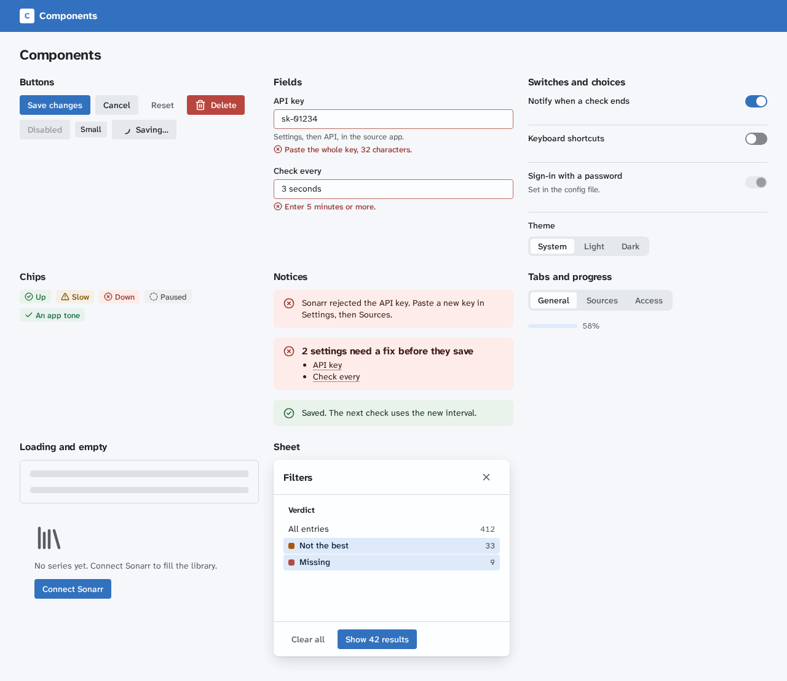

# Components

This page lists the classes in `@cplieger/ui/css/system`. [Design language](design.md) covers the foundations they apply, and [Design patterns](design-patterns.md) how screens use them. Every class applies only where markup uses it.

| Class | What it is |
| --- | --- |
| `.cp-app`, `.cp-header`, `.cp-rail`, `.cp-main`, `.cp-status` | the screen frame |
| `.cp-wordmark`, `.cp-mark`, `.cp-hidden-narrow` | the app's name and mark, and a word the compact tier drops |
| `.cp-nav`, `.cp-nav-item`, `.cp-nav-label` | destinations in the header, the current one filled and in a stronger weight, and a word hidden from sight below 60rem |
| `.cp-rail-toggle` | the Filters button that shows only once the rail leaves |
| `.cp-button` | `data-variant="primary"` or `"quiet"`, `data-size="sm"`, `data-tone`, `aria-busy="true"` while working, and `aria-disabled="true"` on a link without `href` |
| `.cp-field`, `.cp-label`, `.cp-input`, `.cp-help`, `.cp-field-error` | a labelled field, its help and its error, with the danger border on `aria-invalid="true"` and `:user-invalid`, and the warning border on `data-tone="warning"` |
| `.cp-form`, `.cp-input-row`, `.cp-input-wrap` | a column of fields at most 32rem wide, a field with a control beside it, and a field with a quiet control inside its end |
| `.cp-switch` | a native checkbox with `role="switch"`, its thumb at the end when on |
| `.cp-segmented` | one choice of a few, such as a theme, as native radios in labels |
| `.cp-settings`, `.cp-settings-nav`, `.cp-setting`, `.cp-savebar` | a settings page: its categories beside the open one, one setting per row, and the bar that holds unsaved changes, as [Settings](design-settings.md) describes |
| `.cp-gate` | a page outside the frame for one short task, such as sign-in, as [Account and sign-in](design-account.md#the-gate-page) describes |
| `.cp-table` | a data table, with `data-col="select"`, `"num"` or `"actions"` and `data-priority` |
| `.cp-batchbar`, `.cp-batch-count` | the actions for the selected rows and their count, the bar sticking `--cp-sticky-top` from the top, 0 unless a sticky header above it sets its height |
| `.cp-pager` | the range and the Previous and Next links under a table |
| `.cp-chip`, `.cp-notice`, `.cp-swatch`, `.cp-count` | states in a tone, and a count beside a filter |
| `.cp-panel`, `.cp-stack`, `.cp-toolbar`, `.cp-heading-row`, `.cp-crumbs`, `.cp-meta` | surfaces and layout |
| `.cp-filter-group`, `.cp-filter-title`, `.cp-filter` | a filter list with `aria-pressed` |
| `.cp-tabs`, `.cp-tab` | the WAI-ARIA tabs pattern, as [Design patterns](design-patterns.md#tabs) describes |
| `.cp-sheet`, `.cp-sheet-head`, `.cp-sheet-body`, `.cp-sheet-foot` | modal content that opens as a sheet at the inline end |
| `.cp-progress`, `.cp-progress-track`, `.cp-progress-fill` | a progress bar in a tone |
| `.cp-skeleton`, `.cp-empty` | the loading and empty states |
| `.cp-mono`, `.cp-truncate`, `.cp-cell-stack` | machine text, one line cut with an ellipsis, and a title over a muted line |

Inside `.cp`, this package's tooltip, popover, popup, dialog, modal, toast and icons take the language's surfaces, radii, shadows and motion.

