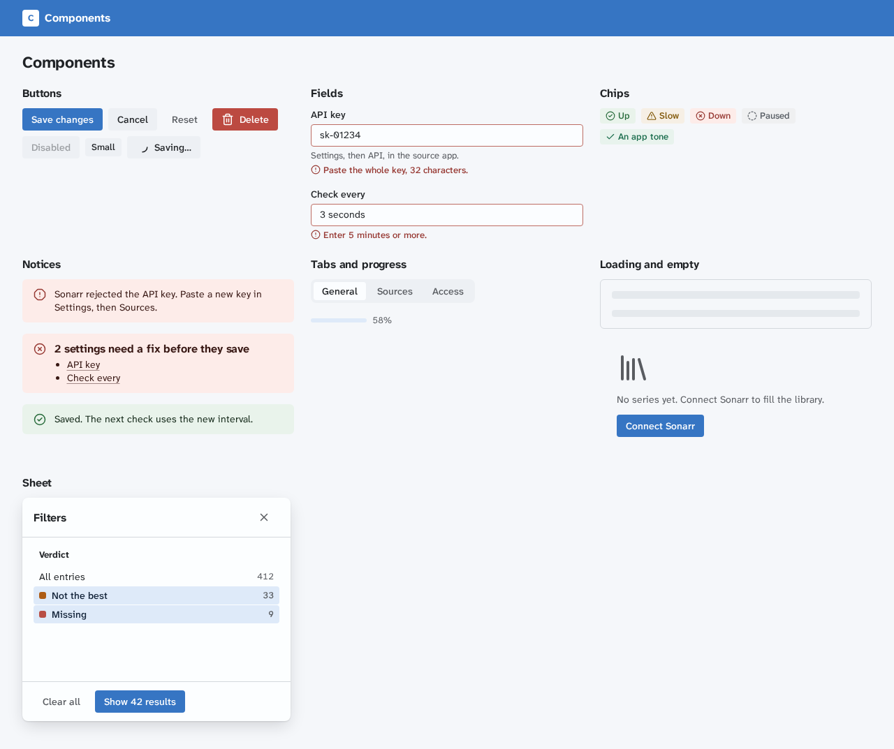

# Design patterns

This page covers the patterns of the design language in `@cplieger/ui/css/system`, for loading, forms, tables, lists, tabs, dialogs, notifications, messages, first run, navigation, language and words. It builds on [Design language](design.md), which covers type, layout, touch and motion, on [Colour](design-colour.md), and on [Components](design-components.md), which lists the classes. [Settings](design-settings.md) covers the settings page, and [Account and sign-in](design-account.md) the screens around an app's accounts.

## Loading

Every region that loads data has four designed states, for loading, empty, error and full. Pick the loading state by what is coming:

| Situation | Show |
| --- | --- |
| The first load of content whose shape is known, such as a table or a list | a skeleton in that shape (`.cp-skeleton`) |
| An action on one control, such as Save or Retry | `spinner-arc` in the control beside its label, with `aria-busy="true"` on it |
| Work with known steps, such as a check of 8 sources | a progress bar (`.cp-progress`) and the step in words, such as "3 of 8" |
| A job that moves through named stages, such as a grab that is found, sent, downloading and imported | a step track (`.cp-track`), in a table row its compact form (`.cp-track-compact`). When the job stops reporting, the track is kept grey with the time it was last known (`data-kept` and `.cp-kept`) |
| Work with no known length, such as a full check that the server accepted | a status line that names the work, the time it started and its latest progress, with Cancel when the work can stop |
| A request with no answer by its own deadline | the error state, with what to try next |

- Show a skeleton through `skeletonTiming(paint, { showDelayMs: 200, minVisibleMs: 400 })` from `@cplieger/ui/skeleton`. A fast answer never flashes a skeleton, and a shown one stays long enough to read.
- Each request has its own deadline, set by the app for that operation. Background work the server accepted is a job, not a pending request. It keeps running past any request deadline, and it moves to the app's activity history when the person leaves the screen.
- Mark the loading region `aria-busy="true"` while it loads, and set `aria-busy="false"` once it settles into empty, error or full. Announce the outcome, such as "12 results" or "Check failed", through `@cplieger/ui/announce`, whose regions are on the page before the load starts.
- A busy button keeps its label and reads as work in progress with an ellipsis, such as "Saving…".
- Empty says what belongs here and offers the one action that fills it (`.cp-empty`). Error says what broke and what to do next, in a notice where the region would be. It never apologises and never stays vague.
- A change that will most likely succeed shows at once and rolls back on failure, through `@cplieger/reactive/actions`. A destructive action asks first or offers an Undo.

## Forms

A form never loses what the person typed, and every error is text that says how to fix it. [form](forms/form.md) shows and clears the errors as steps 3 to 5 ask, from the app's own checks.

1. Each control has a visible `<label>`, with `.cp-help` under it when a format or a source needs saying. A search field in a toolbar is the one exception. It may go without a label when its placeholder starts with "Search" and names what it searches, such as "Search titles…", and its accessible name is the same words.
2. Validate a field when it loses focus and when the form submits, never on every keystroke. Keep submit enabled, so a submit shows what is missing.
3. A field with an error gets `aria-invalid="true"` and a `.cp-field-error` under it, with a `circle-x` icon and a sentence that names the fix, such as "Enter 5 minutes or more". Tie the error to the field with `aria-describedby`.
4. On a submit with one error, focus its field. With two or more, show a danger notice at the top of the form that lists each field as a link to it. Head it with the count, such as "2 settings need a fix before they save", give it `tabindex="-1"` and focus it.
5. Clear a field's error as soon as its value is valid. Never clear what the person typed.
6. While the form saves, the submit button is busy, and the fields stay as they are.
7. A form with unsaved changes asks before a navigation that would discard them.



## Tables

Rows are never interactive. A row's actions are buttons in its last cell, and a destination is a link in the title cell, beside its picture in a `.cp-title-cell`. The row that holds keyboard focus takes the fill a pointer gives a row, so a person tabbing through its actions sees which row they act on.

**Row actions.** A row's action button has a visible word, such as "Grab", and an accessible name that starts with that word and adds the row, such as "Grab Delicious in Dungeon". A row with one action gives it the whole actions column, so a column of actions lines up. More actions go in one `.cp-menu` that every row's ⋯ button opens, and an action that runs confirms in its own cell, with no toast.

**Sorting.** A sortable column's header is a `.cp-sort` button that names the order it will apply, such as "Sort by Size, ascending". The current sort is in the URL and in `aria-sort` on its `<th>`. [table](data/table.md)'s `enhanceSort` names the buttons, moves `aria-sort` and announces the new order.

**Selection.** A table whose rows take a bulk action has a first column, `data-col="select"`, of `.cp-checkbox` boxes:

1. Each row's checkbox has a name that includes its title, such as "Select Mushishi", inside a `<label>` that fills its cell.
2. The header's checkbox selects the rows on this page, and its name says so, such as "Select all 25 entries on this page". It is mixed (`indeterminate`) while some of them are selected. [checkbox](forms/checkbox.md)'s `enhanceSelectAll` does both.
3. A selected row takes the selected fill. Space toggles the focused checkbox. Escape clears the selection while focus is in the table or the batch bar, unless an open menu takes it.
4. With one row or more selected, a `.cp-batchbar` above the table, a `<section>` named by `aria-label`, shows the count, a Clear button and the bulk actions, which name their count, such as "Grab 2". Once the whole page is selected and more rows match, it also offers "Select all 412 entries", which selects every row the filters show on every page. With none selected, the bar is gone.
5. Selection survives sorting and paging. A filter change that hides selected rows keeps them selected and says so in the count, such as "2 selected, 1 hidden by filters".
6. Announce each change to the count through `@cplieger/ui/announce`, politely. [table](data/table.md)'s `enhanceBatchBar` runs the bar, its count, Escape and these announcements.
7. A bulk action that changes or removes data asks first or offers an Undo, as a single action does. Its confirmation names the count.

**A batched action.** Work on more items than one press should send, such as finding subtitles for 248 episodes, goes in batches. The button names what its next press does, such as "Start the first 100", "Start the next 100" or "Start the remaining 48", and after the last batch it is disabled and says "All 248 started". A `.cp-batch-report` under it sums up each press, such as "Started 200 of 248. 48 remain.", then lists each item that did not go, with its reason as a `.cp-state` word. Announce the summary through `@cplieger/ui/announce`, politely. Focus stays on the button while batches remain, then moves to the report, since a disabled button cannot hold it.

**A row that explains itself.** When people need to know why a row is where it is, such as a ranked release, a chevron button in a first `data-col="expand"` column opens a detail row under it, named for what it explains, such as "Why Arid's release ranks first". The detail glides open as every disclosure does. Its content is often a `.cp-facts` list with `data-variant="compare"`, each fact a `.cp-state` word, such as Same or Differs, and a note. The detail starts in line with the row's first data column. A row action whose result matters after it ends, such as Download, turns into a `.cp-outcome` in its cell: a link to the result, or the error with Retry, and focus moves to it. [table](data/table.md)'s `enhanceRowDetail` runs the detail.

**Filters.** While a filter is on, the filters in force sit above the table as a `.cp-active-filters` row, one chip each with its Remove, then Clear filters, and the result count reads "140 of 412". Removing one moves focus to the next chip, or to Clear filters while one is left, and the new count is announced once the person stops removing. [active-filters](data/active-filters.md) runs the row.

**Pages.** A list longer than one page has a `.cp-pager` under its table, inside the panel:

1. It shows the range and the total, such as "1 to 25 of 412", then Previous and Next as links. At the first or the last page that link has `aria-disabled="true"` and no `href`.
2. The page and the page size are in the URL. Offer a page size choice only when people need it.
3. After a page change, focus moves to the table's caption or the first row's title link, and the scroll returns to the top of the table.
4. When the last page empties, such as after a delete, the list moves to the new last page.

## Charts

Pick the form by the question the data answers, after [Datawrapper's guide to chart types](https://www.datawrapper.de/blog/chart-types-guide). A chart with axes is a [chart](data/chart.md), whose [Choosing a chart](data/chart.md#choosing-a-chart) says which form answers which question, from stacked columns per time bucket and bars by category to a timeline strip of who acts when. Outside it:

- A number now is a `.cp-figure` from [Components](design-components.md), with a [sparkline](data/sparkline.md) for how it moved over the range.
- A count that is almost always zero, such as failed checks, is a `.cp-figure`, since a chart of zeros says less than the number.
- Long names and exact numbers go in a table with [ranked bars](data/ranked-bars.md).
- A share of one whole is a [share bar](data/share-bar.md). A state over time, such as a service's last checks, is a [state history](data/state-history.md) strip. A value against its ceiling is a [meter](data/meter.md).

**Columns and bars start at zero.** A column's or a bar's length is its value, so a column or bar chart's value axis always includes 0, as [Datawrapper explains](https://www.datawrapper.de/docs/why-our-column-and-bar-charts-start-at-zero). An area's height is its value too, so its axis includes 0 as well. Lines and dot plots, which place a value rather than draw its length, may start elsewhere.

**Five series at most in a stack.** Each 3px segment on a phone must stand apart from its neighbours and in the legend. Group the smallest into "Other". Give each series a slot of the [series colours](design-colour.md#series-colours), the same slot for the same category on every chart of a screen.

**The duration ladder.** Waits are binned on one ladder. Its edges are 0, 1 sec, 2 sec, 5 sec, 10 sec and 30 sec. In minutes they are 1, 2, 5, 10 and 30, and in hours 1, 2, 6 and 12. In days they are 1, 3, 7, 14, 30 and 90. `durationEdges` from [chart](data/chart.md) returns its edges in milliseconds, and a server in another language bins on the same numbers.

1. Each bin is `[edge, next edge)`, and the last is closed, so every wait from 0 to the last edge lands in exactly one bin.
2. The ladder ends at the first edge at or above the longest wait the data can hold. That is the larger of the retention and the longest wait stored. A retention lowered after older data was written leaves that data in place.
3. Neighbouring edges differ by a factor of 2 to 3, so on a log axis no bin is over 1.6 times another's width. A bar's height can then be its count. A histogram whose bins range wider plots each bin's count per unit of log width, so that its area carries the count. Its y label says so.
4. The ladder grows by adding edges above 90 days, such as 180 and 365, never by moving one below, so stored bins keep their edges.

**Charts that share an x.** Charts stacked on one time range pass the range as their x `domain`. They set `--cp-chart-axis-gutter` and `--cp-chart-label-gutter` once on their common parent, so their plots start and end at the same edges. The eye then runs straight down the screen at one moment. Under 30rem the label gutter is 0, since lines drop their end labels there.

## Lists

A list is a column of rows that each open or name one thing, such as conversations, people or files. Values compared down a column belong in a table.

```html
<ul class="cp-list" aria-label="Conversations">
  <li>
    <a class="cp-list-row" href="#c-feed" data-unread>
      <span class="cp-cell-stack">
        <span class="cp-truncate cp-mono">/workspace/ui/src/data/feed</span>
        <small class="cp-truncate">@codex: The queue moves to you once the scroll fix merges.</small>
      </span>
      <span data-part="end">
        <time datetime="2026-11-11T09:40:00Z">09:40</time>
        <span class="cp-cluster"><span class="cp-badge">2<span class="cp-visually-hidden"> unread</span></span></span>
      </span>
    </a>
  </li>
</ul>
```

1. A row is one target. When the whole row opens one thing, the row is the link (`a.cp-list-row`) or a button. Otherwise it is a `<div>` that holds at most a title link and one worded action, a small plain button whose accessible name adds the row, such as "Download Frieren.S01E04.en.ass".
2. The title and the line under it stay on one line each, cut with an ellipsis at the row's edge. Machine text, such as a path, is `.cp-mono`. A time is a `<time>` through [relative-time](data/relative-time.md), which keeps its words current and gives the exact time on hover and to a screen reader.
3. An unread row carries `data-unread`, which sets its title in the heading weight, beside a badge whose number has the word "unread" for a screen reader, so colour is never the only sign. The open row carries `aria-current="page"`, or `"true"` when the list sits inside the open view.
4. While the list loads, it carries `aria-busy="true"` and holds skeleton rows (`data-skeleton`) in the rows' shape. Empty, it is a `.cp-empty` that names what belongs there and offers the action that fills it, such as "No conversations in the last 72 hours." with New message.
5. Rows that arrive while the person is in the list never push the rows they are reading. A `.cp-list-pending` line above the list says how many wait, and its Show puts them in and moves focus to the first.
6. A row the app could not refresh carries `data-kept`, muted, with a `clock` and the reason in its second line, such as "Kept from 03:00: Radarr is not answering".
7. A list too long to draw is a `.cp-list[data-virtual]` that holds only the rows in view. Each row is keyed by its id, so a live update changes a row in place and the focused row stays drawn. When a filter narrows it, the count of matches is said once typing stops.
8. A list the person puts in order uses [reorder](data/reorder.md): every item has Move up and Move down, so a drag is never the only way, the others slide aside and the new place is said.

## Tabs

Tabs follow the WAI-ARIA tabs pattern:

1. The `.cp-tabs` container is `role="tablist"` with an `aria-label`. Each `.cp-tab` is `role="tab"` with an `id`, `aria-controls` naming its panel, and `aria-selected`. Each panel is `role="tabpanel"` with `aria-labelledby` naming its tab, and the panels of the other tabs are `hidden`.
2. The tablist is one Tab stop, the selected tab. [tabs](navigation/tabs.md) moves focus between tabs with the arrow keys, Home and End, and slides the pill under the selected one.
3. Moving focus selects the tab when its panel is already loaded. When a panel loads on demand, Enter or Space selects it instead.
4. The selected tab is in the URL.
5. When each tab is its own address, the tabs are links in a `.cp-link-tabs` nav and the current one carries `aria-current="page"`.

## Dialogs and sheets

A dialog is the last answer, after inline editing and disclosure. When one is needed:

- Make it a native `<dialog class="cp-dialog">` opened with `commandfor` or `showModal()`, as [dialog](overlays/dialog.md) describes. The modal dialog makes the page inert, closes on Escape and returns focus to the control that opened it.
- Move focus by what the dialog holds. A form focuses its first field. A confirmation focuses its least destructive action. A dialog of content to read focuses its heading.
- A destructive confirmation names the action and its object on its button, such as "Delete 3 subtitles", and uses `data-tone="danger"` on it.

A sheet is a `.cp-dialog` marked `data-variant="sheet"`, with the same header, body and footer. It opens at the inline end at full height, and across the whole window in the compact tier. The filter sheet is the standard one:

1. Below 60rem, a Filters button in the page toolbar opens the rail's filters in a sheet. Its label carries the count of active filters, such as "Filters, 2", and while any filter is active, a "Clear filters" button sits beside it. Both carry `.cp-rail-toggle`, which marks a toolbar control that serves the rail once it is gone: the stylesheet shows them only below 60rem, where the rail is hidden.
2. The head holds the title "Filters" and a Close button.
3. A sheet with one group of filters whose results come back fast applies each change at once and writes the URL. Its foot holds "Clear all" and "Done", and Close and Escape keep the changes.
4. A sheet with several groups, or whose results are slow, stages the changes. Its foot holds "Clear all" and "Show 41 results", which applies them as one URL entry and closes the sheet. Close and Escape discard what was staged.
5. A filter set too long for a sheet is a page of its own, with Back returning to the list.

## Notifications

| Situation | Use | Stays |
| --- | --- | --- |
| A problem with one region, such as a source that failed to answer | a notice where the region is | until the problem ends |
| A condition of one screen, such as a rate limit on the source it lists | a notice at the top of `.cp-main` | until the condition ends |
| A condition that stops the person's work on every screen, such as an update that needs a reload, or a lost connection in an app with no header status | a `.cp-banner` at the top of `.cp-main`, with its one action and no dismiss | until the condition ends |
| A lost connection in an app with a header status | the status's offline state alone, with its way to retry in the status's panel | until the connection is back |
| A confirmation on the control the person pressed, such as Saved on Save or Copied on Copy | the control itself, through [confirm](buttons/confirm.md) or [copy](forms/copy.md). Copy announces its word, and a confirm's outcome is yours to announce | 1.6 seconds |
| A short confirmation of the person's own action, such as "Source added", whose result stays visible on the screen or in the history | a toast | 7 seconds, paused while hovered or focused |
| A confirmation whose result is not visible anywhere else | a toast | until dismissed |
| A failure of the person's own action | a toast, with Retry when it can be retried | until dismissed |
| The outcome of background work, such as a finished check | the app's activity history (`.cp-history`), and a toast only when the person started it | in the history |

- Show each toast with `toast()` from `@cplieger/ui/toast`. A passing toast stays 7 seconds, and an error or a toast with an action, such as Undo, stays until dismissed on its own.
- Toasts announce themselves, confirmations politely and errors assertively, so use an error toast only for a failure of what the person just did. A failure of background work, such as a refresh, is a notice, announced politely.
- A notice that appears announces through `@cplieger/ui/announce`, politely, and only one that blocks the person's current task uses `role="alert"`.
- One message per event. A problem shown in a notice is not also a toast.

## Messages

A conversation is a [feed](data/feed.md): its messages oldest first, with the composer pinned under them.

1. The feed opens at the newest message. While the person is at the end, a message that arrives keeps the newest in view. Once they have scrolled up, nothing that arrives moves them. A New messages button above the composer counts the arrivals and says its words politely, and a press takes them to the newest and moves focus to it.
2. A day separator stands where the day changes, and "New since your last visit" before the first message the person has not seen.
3. The person's own messages sit on the sunken fill with "You" as the author, their text on the same edge as everyone else's. No bubbles, and no coloured edge.
4. A message shows in the feed as soon as it is sent, muted with "Sending…", and the feed scrolls to it wherever the person was. A send that fails turns it into "Not sent." with Retry, and keeps the text in the composer.
5. The composer is a form like any other. Send stays enabled, so a press with an empty field says what is missing. Ctrl+Enter, or Command+Enter on a Mac, sends, and Enter breaks the line. On a phone the composer stays above the on-screen keyboard, and it never covers the last message.
6. "Read by 3 of 5" opens who has read the message and who has not yet, with its own loading and error states.
7. What surrounds the conversation, such as its reservations and followers, is a [context-panel](layout/context-panel.md): a column beside the feed in a wide box, and a disclosure above it in a narrow one.

## First run

An app whose data comes from another service has these states before it shows any data. Each one is a `.cp-empty` with its own heading, sentence and action, or a loading state where the table says so:

| State | Says | Action |
| --- | --- | --- |
| Not set up | what the app needs to start | the setup step that is missing, such as "Connect Sonarr" |
| Connecting | which service it is reaching | none, it is a loading state |
| Connection failed | which service failed and what it answered | "Check settings", which opens the field at fault |
| First sync running | what is being read, and its progress | "View activity" |
| Sync failed | which step failed and what the service answered | "Retry sync" |
| The service has no items | that the service answered and holds nothing yet | "Open Sonarr", a link to the service |
| Filters hide everything | which filters are active | "Clear filters" |

First sync running is a `.cp-empty` whose heading starts with a `.cp-loader`, then a `.cp-progress` whose words name the phase and the step, such as "Series 120 of 351", repeated in its `aria-valuetext`, then "View activity". Connection failed and Sync failed lead with a `circle-x` glyph in `data-tone="danger"`.

## Navigation and the URL

- The URL is the state. Filters, sort, search, the open tab, the page of a list and an open sheet each live in the path or the query, so a link, a refresh and Back reopen the same view.
- A navigation pushes a history entry, and a change while typing replaces the current one, so Back does not walk through every keystroke.
- Back and Forward restore the view, its scroll position and the focus they left.
- A route change moves focus to the new screen's `<h1>` and sets `<title>` to the screen's name.
- A link to something that is gone, or a query value the app does not know, opens the nearest valid view with a notice that says what was dropped.
- A destination is a link (`<a href>`), so a middle click, a new tab and a copied address all work. A button is for an action on this screen.
- A destination that shows only its icon, from 40rem to 60rem, keeps its word as its accessible name through `.cp-nav-label`, which the stylesheet hides from sight only, and a tooltip with the same word. Under 40rem the header's destinations move to a bar at the window's foot, each an icon over its word.
- The header holds four destinations at most, so each keeps its word on one line in the bar under 40rem. Others go in a menu or on a screen of their own.
- The current destination carries `aria-current="page"`, or `"true"` when the screen sits inside it, as an item sits inside its library.
- A screen opens with its `.cp-crumbs`, then a `.cp-heading-row` holding the `<h1>` with its `.cp-meta` line of facts under it, and the screen's `.cp-toolbar` at its end.

## Language and direction

The interface may ship in one language and still show titles, names and file names in any script.

- Set `lang` on `<html>`, and `lang` on an element whose text is known to be in another language, such as a Japanese title.
- Wrap text from outside the app, such as a title or a release name, in `<bdi>` or give its element `dir="auto"`, so a right-to-left name cannot reorder the text around it.
- Format dates, times, numbers, sizes and durations with `Intl`, in the person's locale.
- The stylesheet uses logical properties throughout, so it mirrors under `dir="rtl"`. Write app CSS with `inline` and `block` properties the same way. Icons that point along the text mirror on their own.
- Test a screen with long words and with a right-to-left title in a table cell, and test one whole screen under `dir="rtl"` at compact and expanded widths, with its sheet open.

## Words on screen

- Sentence case everywhere, buttons included.
- A button is a verb and its object, such as "Save changes" or "Find subtitles". An action keeps its name through the flow, so "Publish" leads to "Published".
- A menu item that asks for more input, and a label for work in progress, end with an ellipsis, such as "Rename…" and "Saving…".
- Numbers are numerals with a non-breaking space before their unit, such as 31.4 GB and 3 of 8.
- Errors name the problem and the way out. Empty states name what belongs there.
- Help text is a last resort. A clear label and a sensible default come first.
- Never invent a number, a quote or a logo on a screen. An absent fact stays absent.

## Not yet decided

The language decides these when an app first needs them, and adds them here:

- Print styles.
