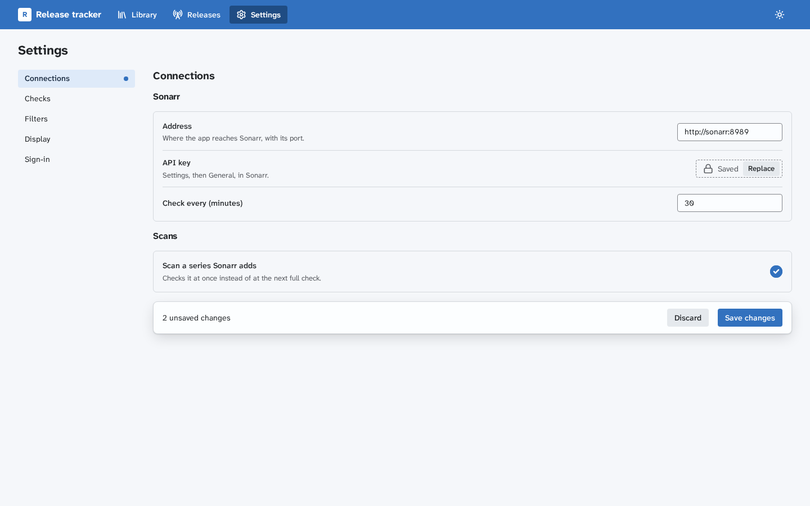

# Settings

This page covers the settings page every app has. It builds on [Design patterns](design-patterns.md), whose rules for forms, errors and words apply here too, and on [Components](design-components.md) for the classes.

## The page

1. The page heads with the `<h1>` "Settings". Its categories are a plain compact [list](data/list-row.md) of `a.cp-list-row` links in a `.cp-settings-nav`, the open one with `aria-current="page"` and a category with unsaved changes holding a `.cp-dot` in its end with ", unsaved changes" for a screen reader, beside the open category in a `.cp-settings`. Below 48rem they become a select labelled "Category" above it, whose changed categories read "Checks, unsaved changes". [settings](layout/settings.md) makes the select, writes the dots and, on a page of sections, marks the category in view; without script the links stay, in a row that scrolls sideways.
2. Each category has its own address, such as `/settings/connections`, and its own `<h2>`. Opening Settings opens the first category.
3. A category holds its settings in groups, each a `<section>` with a heading over a `.cp-panel` of `.cp-setting` rows.
4. A row holds the label and its `.cp-help` at the start and the control at the end. A wide control, such as a text field or a list, wraps under the words.
5. Fields sit in a `.cp-form`, so none is wider than what it holds.

## Saving

A category saves in one of two ways, never both:

- **At once**, for a preference that is safe to change and easy to change back, such as the theme, notifications or density. The control's new state is the confirmation, with no toast. A change the server refuses goes back, and an error toast says why, with Retry.
- **With Save**, for settings that are checked together, need a restart, or reach other people or services, such as connections, providers or sign-in. While any change waits, a `.cp-savebar` at the bottom of the form names the count, such as "3 unsaved changes", with "Discard" and the primary "Save changes". A category with waiting changes carries a dot in the list. Leaving with changes asks first, through [form](forms/form.md#unsaved-changes)'s `guardChanges`, whose `within` accepts every category's address and Settings' own, so moving between categories keeps the changes and their dots, and only a link out of Settings asks. Errors follow the [form rules](design-patterns.md#forms), with the summary and each field's error. The guard decides what waits, from each field's saved value as its default, and [settings](layout/settings.md) paints the bar, its count and the dots from it. After a save, the saved values become the defaults, so Discard, the count and the dots start from them.

An error the summary lists names its category before its field, such as "Account and security: Display name", and its link opens that category first. An error with no field of its own, such as two sources sharing one address, is listed under its category's link, and an error about the whole document, such as a newer copy saved elsewhere, is a banner `.cp-notice`, as [form](forms/form.md) describes.

When the settings change on another device while the person edits, a warning `.cp-notice` says so, such as "These settings changed on another device while you were editing.", with "Load the latest and keep my changes": it takes the newer values, keeps every field the person changed, and notes under a field changed on both sides what was saved elsewhere.

A save says what it did or when it takes effect, such as "Saved. 6 copies changed." or "Saved. Applies after a restart."

While any saved change waits for a restart, a warning `.cp-notice` with reasons sits at the top of the settings: its head, such as "2 saved changes wait for a restart", one line per change saying what happens and in which direction, such as "Authentication turns off at the next restart.", and a foot with the way to restart. It blocks nothing and leaves once the app has restarted.

## Controls

- A `.cp-switch`, a native checkbox with `role="switch"`, is for an on or off that takes effect at once. Its label names the setting and stays the same in both states. In a category with Save, the same on or off is a `.cp-checkbox`, since a switch reads as already applied.
- A `.cp-segmented` choice is for two to four short options, such as System, Light and Dark. More, or longer, options take a `.cp-select`.
- A number with a unit names the unit in its label or its help, such as "Check every (minutes)".
- A small count with a short range, such as parallel checks from 1 to 8, is a `.cp-stepper` from [stepper](forms/stepper.md).
- A radio that needs a value of its own, such as "Every 30 minutes", holds a `.cp-choice-field`, as [choice](forms/choice.md) describes.
- A setting this page cannot change, because a config file, the environment or an administrator sets it, shows its value in a `.cp-set-elsewhere` line where the control would be, with a neutral `.cp-chip` naming where it is set, such as "from config.yaml", and one sentence of help on how to change it, such as "Changes only at startup: edit config.yaml and restart subflux." It is never a disabled control, so its value stays readable and selectable.
- A stored secret, such as an API key, shows "Saved" and "Replace". Replace opens an empty field with a Show button inside it, in a `.cp-input-wrap`, and "Keep saved value" puts the saved one back. A save sends nothing for a kept secret. [secret](forms/secret.md) drives Replace, Keep saved value and the Show button.
- A secret the server takes from its environment is a `.cp-set-elsewhere` line too: its `.cp-state`, such as Set, Not set or Rejected, stands in place of its value, which it never shows.
- Several values from a fixed set, such as the subtitle formats to ignore, follow [Several from a fixed set](design-patterns.md#forms): a few are checkboxes in a `.cp-choices` with "Reset to default" at the end of the legend's line.
- A service the app reaches gets "Test connection" from [`@cplieger/ui/connection-test`](forms/connection-test.md), which marks the field at fault.

## Appearance

- The theme is a `.cp-segmented` choice of System, Light and Dark, saved at once through [`@cplieger/ui/theme`](core/theme.md). While System is chosen, its label says what the system shows now, such as "System (now dark)", which `onSystemChange` keeps true.
- The header may carry a theme toggle, a `.cp-toggle` with `data-kind="theme"` from [toggle](buttons/toggle.md), named "Dark theme" and pressed while the theme is dark, so one press switches between light and dark. System stays a choice on this page.

## Words

- Category names are nouns, such as "Connections", "Languages" and "Sign-in".
- A label names the setting, never "Enable" or "Disable" in front of it. Help says the effect or the format, in one sentence.
