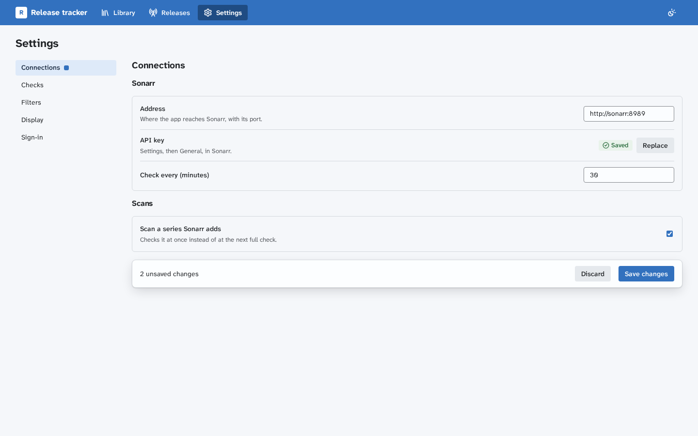

# Settings

This page covers the settings page every app has. It builds on [Design patterns](design-patterns.md), whose rules for forms, errors and words apply here too, and on [Components](design-components.md) for the classes.

## The page

1. The page heads with the `<h1>` "Settings". Its categories are links in a `.cp-settings-nav`, the open one with `aria-current="page"`, beside the open category in a `.cp-settings`. Below 48rem they sit in a row above it.
2. Each category has its own address, such as `/settings/connections`, and its own `<h2>`. Opening Settings opens the first category.
3. A category holds its settings in groups, each a `<section>` with a heading over a `.cp-panel` of `.cp-setting` rows.
4. A row holds the label and its `.cp-help` at the start and the control at the end. A wide control, such as a text field or a list, wraps under the words.
5. Fields sit in a `.cp-form`, so none is wider than what it holds.

## Saving

A category saves in one of two ways, never both:

- **At once**, for a preference that is safe to change and easy to change back, such as the theme, notifications or density. The control's new state is the confirmation, with no toast. A change the server refuses goes back, and an error toast says why, with Retry.
- **With Save**, for settings that are checked together, need a restart, or reach other people or services, such as connections, providers or sign-in. While any change waits, a `.cp-savebar` at the bottom of the form names the count, such as "3 unsaved changes", with "Discard" and the primary "Save changes". A category with waiting changes carries a dot in the list. Leaving with changes asks first, and errors follow the [form rules](design-patterns.md#forms), with the summary and each field's error.

A save says what it did or when it takes effect, such as "Saved. 6 copies changed." or "Saved. Applies after a restart."

## Controls

- A `.cp-switch`, a native checkbox with `role="switch"`, is for an on or off that takes effect at once. Its label names the setting and stays the same in both states. In a category with Save, the same on or off is a checkbox, since a switch reads as already applied.
- A `.cp-segmented` choice is for two to four short options, such as System, Light and Dark. More, or longer, options take a select.
- A number with a unit names the unit in its label or its help, such as "Check every (minutes)".
- A setting the server takes only from its config file shows its value as text, with the help "Set in the config file. Changes when the app restarts."
- A stored secret, such as an API key, shows "Saved" and "Replace". Replace opens an empty field with a Show button inside it, in a `.cp-input-wrap`, and "Keep saved value" puts the saved one back. A save sends nothing for a kept secret.
- A service the app reaches gets "Test connection" from [`@cplieger/ui/connection-test`](connection-test.md), which marks the field at fault.

## Appearance

- The theme is a `.cp-segmented` choice of System, Light and Dark, saved at once through [`@cplieger/ui/theme`](theme.md). While System is chosen, its label says what the system shows now, such as "System (now dark)", which `onSystemChange` keeps true.
- The header may carry the same choice as one icon button that steps through the three, with the choice in its accessible name and tooltip, such as "Theme: System".

## Words

- Category names are nouns, such as "Connections", "Languages" and "Sign-in".
- A label names the setting, never "Enable" or "Disable" in front of it. Help says the effect or the format, in one sentence.
