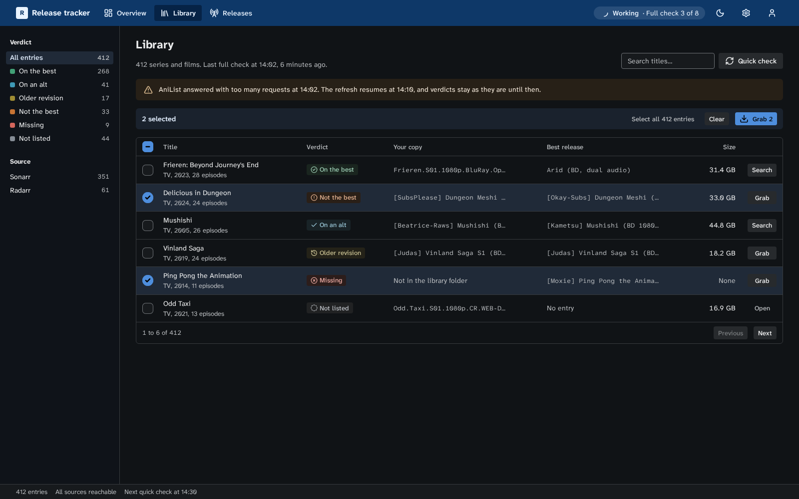
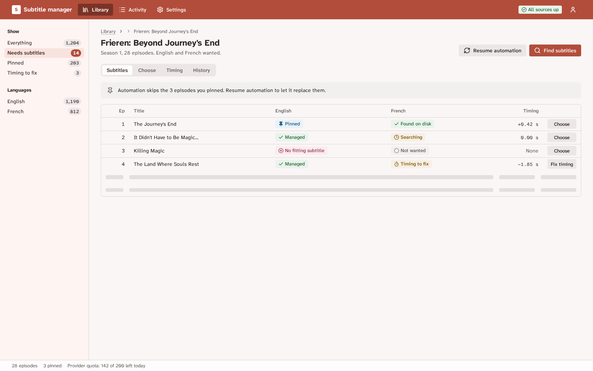
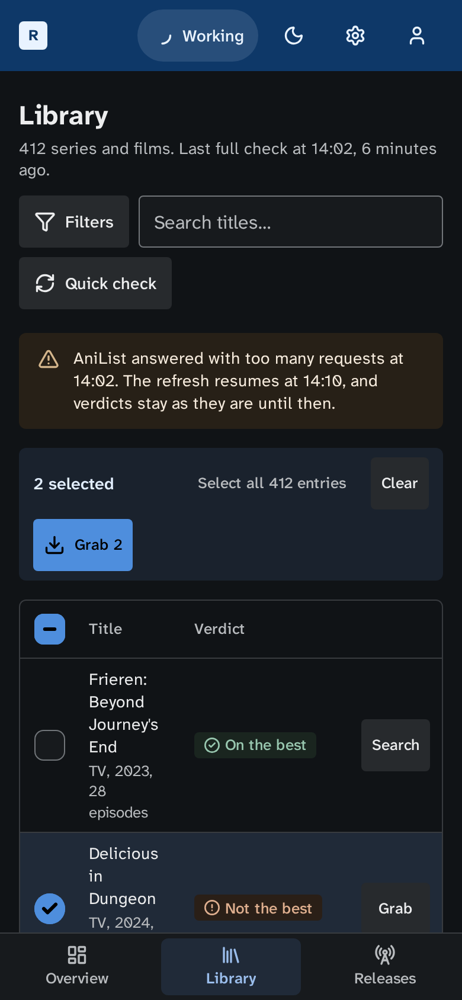
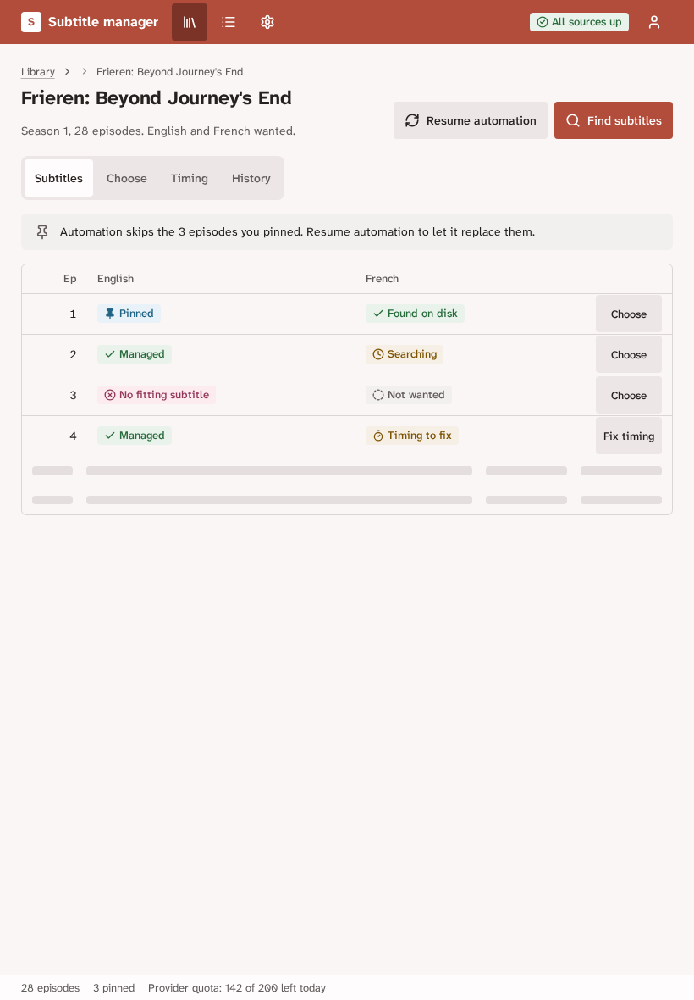
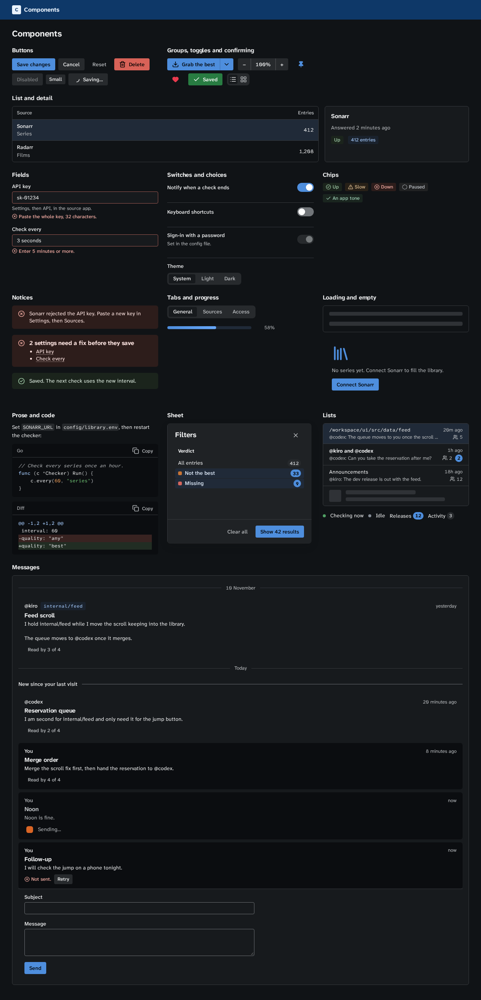

# Design language

This page covers the foundations of the design language that `@cplieger/ui/css/system` implements, for type, layout, touch, shape and motion. [Colour](design-colour.md) covers its colours and [Components](design-components.md) its classes. [Design patterns](design-patterns.md) covers loading, forms, tables, lists, tabs, dialogs, notifications, messages, first run, navigation and language, [Settings](design-settings.md) the settings page, and [Account and sign-in](design-account.md) the screens around accounts. Read this page and the patterns before you build a screen with the stylesheet. [Principles](principles.md) covers how the parts are built.

The language is for screens someone works in, such as libraries, queues, settings and logs, so the layout, the navigation and the controls stay the ones people already know.



## What an app chooses

The stylesheet fixes the controls, the navigation, the type, the spacing, the radii, the control sizes and the motion. An app chooses the rest:

1. Its colour seeds, a hue and a chroma each for its accent, its neutrals and, if it differs, its brand.
2. Which [series colour](design-colour.md#series-colours) each category in its data takes, such as one slot per verdict with `data-series`, and its own tones for states the built-in ones do not name.
3. The shapes of its own information, built from the language's tokens, such as the verdict bar of a release tracker or the timing track of a subtitle editor. These carry most of an app's identity, so give each one a job in the task.
4. Its words, so labels, buttons and messages use the app's own vocabulary.

## Set up

1. Import `@cplieger/ui/css/system`. Its `@font-face` rules point at `../fonts/` and its drawn glyphs at `../icons/`, so a bundler that follows `url()`, such as esbuild or Vite, copies those files with the CSS.
2. Put `class="cp"` on `<html>`. Without it the file defines custom properties and fonts and styles only the `.cp-*` classes your markup uses, so an app can adopt it one subtree at a time. Inside `.cp`, the `hidden` attribute always hides, even on a class that sets `display`.
3. Set your seeds in your own unlayered `:root`, after the import. The steps are computed on `:root`, so a seed set on another element changes nothing there. To colour one region differently, give it a tone.
4. Set `data-theme="light"` or `data-theme="dark"` on `<html>` before first paint from an external blocking script. `@cplieger/ui/theme` writes this attribute. With no attribute, the page follows the operating system.
5. Set `data-pointer` with [`@cplieger/ui/pointer`](core/pointer.md), as [Touch and mouse](#touch-and-mouse) shows.
6. Call `installPress()` from [`@cplieger/ui/press`](core/press.md) at startup, so a press shows under a finger too, and `installRadioFocus()` from [`@cplieger/ui/radio-focus`](core/radio-focus.md), so Safari keeps the focus ring on a radio the arrow keys reach.
7. Set `lang` on `<html>`, and `dir` when the interface language reads right to left.

```css
:root {
  --cp-accent-h: 255;
  --cp-accent-c: 0.137;
  --cp-neutral-h: 255;
}
```

A JSR install reads the stylesheet, fonts and icons from the package files `css/`, `fonts/`, `icons/svg/` and `icons/marks/`.

The stylesheet needs `contrast-color()`, `light-dark()`, relative `oklch()`, `color-mix()`, `@scope` and container queries, which ship in Chrome 147, Firefox 146 and Safari 26.4 and later.

## Colour

[Colour](design-colour.md) covers the seeds an app sets, the 12 steps and their roles, light and dark, contrast, tones, harmony colours and series colours.

## Type

- Text is Atkinson Hyperlegible Next, a face drawn so that similar letters such as I, l and 1 stay distinct. Machine text, such as file names, release names, hashes and offsets, is Atkinson Hyperlegible Mono, through `.cp-mono` or `<code>`.
- The fonts cover Latin scripts. Other scripts, such as a Japanese title, use the system's fonts.
- Mono is for machine text only. Labels, numbers and headings stay in the text face.
- The scale steps by about 1.2: 13, 14, 16, 19, 23, 28 and 34px, from `--cp-text-xs` to `--cp-text-3xl`. Interface text is 14px and metadata 13px, and no sans text is smaller. Machine text in `.cp-mono` is set at 0.92em of the text around it, because its letters run about 30% wider than the sans at the same x-height.
- Headings are `h1` 23px, `h2` 19px, `h3` 16px and `h4` 14px, at one weight (700) and one colour, balanced over their lines. A setup step's `h1`, under its steps on a gate page, is 19px. The 28px step is a [figure's](design-components.md) number, and the 34px step is for an app's own larger figures.
- Prose lines stop at 68 characters.
- Numbers that line up in a column use tabular figures: `data-col="num"` in a table, `.cp-badge`, `<time>`, `<data>` and `<output>`.
- Labels, table heads and captions are sentence case at normal letter spacing, never tracked capitals.

## Space and layout

Spacing steps on a 4px grid, from `--cp-space-1` (4px) to `--cp-space-16` (64px). Space is tight inside a group, wide between groups, and larger above a heading than below it.

`.cp-app` lays out a screen: `.cp-header` for the mark, the destinations and the global controls, `.cp-rail` for filters, `.cp-main` for the work and `.cp-status` for one line of facts about the whole screen, each a `<span>`. A part with `data-state="late"`, for work that has not run when it should have, takes the warning ink and a clock. Main's content keeps a measure of 90rem, centred on a wider window, and `data-width="full"` on `.cp-main` lets a screen that needs the window, such as a wide table, take it. Under 40rem the header's `.cp-nav` becomes a bar fixed at the window's foot, each destination an icon over its word, and the frame leaves room for it. A `.cp-skip` link, the first element of the page, takes a keyboard past the header to `.cp-main`, which carries an `id` and `tabindex="-1"`.

The width tiers follow the space in the window, not the device:

| Tier | Window width | Layout | Usually |
| --- | --- | --- | --- |
| Compact | under 40rem | one column, only the mark of the wordmark with the header's toolbar beside it, on a second row when it does not fit, and the destinations in a bar at the window's foot | a phone, or a narrow split window |
| Medium | 40rem to 60rem | no rail, and destinations show their icons without their words | a tablet held upright |
| Expanded | 60rem and up | header, rail, work area and status line | a tablet held sideways, a laptop or a desktop |

Below 60rem, the rail's filters move into a sheet behind a Filters button, as [Design patterns](design-patterns.md#dialogs-and-sheets) describes.

Inside a region, an element follows its own box. A heading row's toolbar takes a line of its own once the row is under 40rem wide, in a narrow detail panel as on a phone. A table column carries its priority. In a container under 64rem, `data-priority="low"` columns leave. Under 44rem, `data-priority="mid"` columns leave too. The selection box, the title, the state and the row's action never leave. A table wider than its panel scrolls inside `.cp-panel[data-flush]`. Nothing else is wider than the window at 320px, and nothing is clipped.

## Touch and mouse

Width and input are separate, since a tablet can have a trackpad and a laptop a touchscreen. The stylesheet sizes controls from `data-pointer` on `<html>`:

| `data-pointer` | Controls | Table rows | Hit area |
| --- | --- | --- | --- |
| `fine` | 32px, 26px small | 36px | 24px at least |
| `coarse` | 44px, small too | 48px | 44px at least |

[`@cplieger/ui/pointer`](core/pointer.md) sets it. `applyPointerTier` writes a first value from the pre-paint script, and `installPointerTier` follows each real pointer, a mouse or a trackpad as `fine` and a finger or a pen as `coarse`:

```ts
applyPointerTier({ storageKey: "app.pointer" }); // pre-paint
installPointerTier({ storageKey: "app.pointer" }); // at startup
```

Hover styles apply under `@media (any-hover: hover)` while `data-pointer` is not `coarse`, so a tapped control keeps no hover fill. Pressed and focus styles apply on every tier. A press scales the control to 97%, except an icon-only button, which takes the pressed fill instead, since a scaled 18px icon blurs on a 1x screen. A checkbox or radio pressed through its label scales to 88% and springs back. On touch an input stays at 16px so iOS does not zoom.

A press is drawn from `:active` and from the `data-cp-pressed` that [press](core/press.md) sets, since iOS Safari gives a tapped control no `:active`. Controls take `touch-action: manipulation`, so a fast second tap never zooms the page.

## Shape and depth

- Radii are 4px for controls and chips, 6px for surfaces and 8px for overlays. A child inside a padded parent takes the parent's radius minus the padding, so nested corners stay concentric.
- An in-flow surface separates from its neighbour by a fill step or one line, never both. Panels are outlined, and nested cards do not exist.
- A shadow, tinted by the neutral hue, marks an overlay a gesture opened, such as a menu, a dialog or a toast, and nothing else.
- No surface, row or notice carries a coloured leading edge. A state is a tinted fill, a glyph and a word.

## Motion

Motion shows what changed.

| Token | Value | Use |
| --- | --- | --- |
| `--cp-dur-micro` | 90ms | colour and fill changes |
| `--cp-dur-press` | 60ms | a press going down and coming back |
| `--cp-dur-short` | 160ms | small movements, a popover opening |
| `--cp-dur-medium` | 240ms | a toast entering |
| `--cp-dur-long` | 360ms | a view transition between screens |
| `--cp-dur-exit` | 120ms | anything leaving |
| `--cp-dur-spring` | 520ms | a spring, such as a switch's thumb, a checkbox's turn or a radio's dot |

- Entrances ease out (`--cp-ease-out`), exits ease in (`--cp-ease-in`) and are shorter, and moves between two places use `--cp-ease-move`.
- `--cp-ease-spring` is a spring sampled into `linear()` that overshoots about 13%, for something that travels or settles, such as a sliding pill or a dialog. A spring never plays on an undo path, which eases out instead. `--cp-ease-bounce` overshoots about 27%, for a mark that pops in, such as a radio's dot.
- Movement animates `transform` and `opacity`, and a width only where an element makes room for new content, such as a confirm button gliding to its new words or a filter chip's check sliding in. Colour, fill and border changes take `--cp-dur-micro`, except a control's own state, whose colour follows its motion: a switch's track takes 200ms, and the fill of a checkbox, a radio or a filter chip 160ms. A done fill flashes in within 160ms and fades back over 600ms, or 900ms on Copy. A `.cp-progress` fill glides to each step over 480ms. Done fades it to the success solid over 500ms once the last step has arrived, and its check pops in on `--cp-ease-bounce`. A chip whose state changes while the person watches shows its tone's solid at 110% and fades back to its wash from the first fifth of 900ms, through `flashChip` from [chip](feedback/chip.md). List the properties, never `transition: all`.
- Nothing animates on load, on scroll, or on an action repeated all day, such as typing or switching tabs: a tab's panel appears at once, and only the pill under the selected tab slides. A detail or dialog a page loads with already open appears without its entrance, as [List and detail](layout/list-detail.md) shows.
- A `.cp-dialog` fades in and settles from 96% on `--cp-ease-spring` over `--cp-dur-medium`, rising from the bottom edge in the compact tier, and fades out over `--cp-dur-short`. A docked detail slides in from the inline end over `--cp-dur-medium`. A sheet slides in from the inline end over 300ms and out over 280ms. A popover grows out of its button in 180ms and shrinks back in 140ms. A row the person adds to a list, such as a rule or a pair of fields, fades in and settles 4px over 200ms. The items of a list the person reorders slide aside over `--cp-dur-medium` on `--cp-ease-move`, and the one a drag lifted follows the pointer.
- A route change cross-fades through `@cplieger/ui/view-transition`. Inside `.cp`, the stylesheet gives it `--cp-dur-long`. A theme change from a theme toggle grows the new look in a circle from the button over 480ms instead, through `viewTransition(fn, { from })`, and cross-fades under reduced motion.
- Under `prefers-reduced-motion: reduce`, presses do not scale, a flashing chip keeps its colour and does not grow, the skeleton and `spinner-arc` stand still, a `.cp-progress` fill jumps to each step and its check only fades in, medium, long and spring durations drop to `--cp-dur-short`, both springs ease out, a dialog, a docked detail or an added row only fades, and reordered items move at once. A loop that runs longer than 5 seconds has a pause control.
- A pulsing or beating mark is for something that is live right now, such as a running check. A static state stays still.

## Components

[Components](design-components.md) lists every class the stylesheet ships and what it is for.

## Icons

Icons come from `@cplieger/ui/icons`, which holds Lucide's drawings plus a few of its own (filled pin, heart, funnel and tag, and `spinner-arc`), all drawn with a 2.25-unit stroke on a 24-unit grid and painted in the text colour. At the 18px `ui` size that stroke is 1.7px, which a 1x screen still draws solid, so an icon holds the weight of a medium label beside it. Sizes are `inline` (1em), `ui` (18px), `lg` (24px) and `hero` (48px). An icon is decorative. The control that holds it carries the name, and every icon-only control, links and tabs included, has an accessible name and a tooltip with the same words. A drawing whose name ends in `-left` or `-right` faces the other way in a right-to-left context.

## Reference screens

The pages in `docs/system/` render the screens on these pages, on [Settings](design-settings.md) and on [Account and sign-in](design-account.md) from the shipped stylesheet, with no script. After a change to the stylesheet, the pages, the fonts or the icons, run `npm run system:screens` to capture them again into `docs/images/`, and a test fails until you do.








